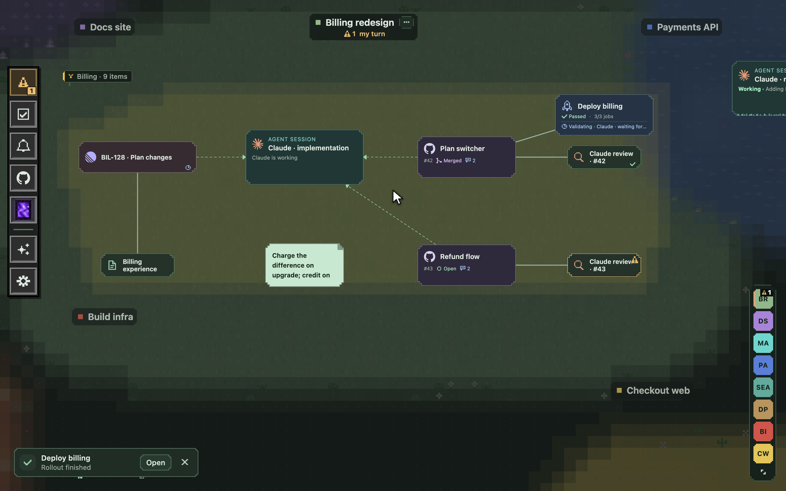

# Agentic Crafting Table

**Focus on one thing. The map keeps track of everything else.**

Running more than a few agents at once meant polling them all day, forgetting the
ones that mattered, and losing the ticket, the thread and the notes between switches.
Agentic Crafting Table is a desktop app for that. Every project is a neighbourhood on a
zoomable map; every piece of work is an item on it: an agent session, a ticket, a note,
a pull request, a review, a rollout. You link items to say what feeds what, and the
map remembers where you were.



Two rules govern the design. **One item in focus at a time**: the rest stays visible on
the map as context, not in another tab. **Agents can change the map**: they get an MCP
server, so an agent puts its own pull request, review and notes where they belong.


## Features

**A map, not a list**
- Every project is a neighbourhood; every piece of work is an item on it. Open an item
  by zooming into it and it keeps its place, links and all. Pan the map around an open
  item to see what sits next to it.
- Link items to say what feeds what: a ticket into an agent, a brief into a pull
  request, a pull request into its rollout.
- Zoom out and projects become dashboards: who needs you, what is working, the
  pull request pipeline. Zoom out further for the whole table.
- Three items close together form a plot with a signpost; drag the sign to move them all.
- ⌘F finds any item; the Projects panel lists every project as a tree with filters,
  folds, drag-to-order and a pin to keep it open.
- Two fingers on a trackpad pan, a pinch zooms; a mouse wheel zooms.

**Agents that know where they are**
- Start Claude or Codex in a project folder. They get the project's context and an
  MCP server, read the map, add to it and link what they make.
- Resume a saved conversation later; reconnect to a running one after a restart.
  `/new`, `/fork` and `/resume` typed in the terminal follow the CLI on the map.
- Run installed project skills as tracked native runs, with a model of your choice.
- Agents get short, auto-generated titles from what they are doing, and the map shows
  when one stops or asks.
- Claude artifacts open inside their item, signed in, so a spec or a diagram an agent
  published stays next to the work.

**Needs me, not notifications**
- One panel lists what is waiting for you: an agent with a question, a review request,
  a failed rollout. Mark it seen and it leaves; opening it can mark it seen too.
- Native banners when the app is in the background, if you want them.
- A stand-up summary of what moved since you last looked.

**Reviews you can act on**
- **Automatic reviews**: every pull request that lands on the map gets a review from
  Claude, Codex or both, if you switch it on.
- A review opens as a triage desk: findings by severity, each one sent to the
  implementing agent, ignored or kept. Fixed findings report back.
- **Review loop** runs a review, fixes the critical and high findings, and reviews again
  until a round comes back clean.
- **Explain architecture** starts a read-only Claude session on a large pull request and
  publishes a components overview and flow diagram as a Claude artifact.

**GitHub without the browser**
- Pull requests show their conversation with new comments marked and images inline,
  replies, Fix with agent and one-click merge, or merge when ready.
- GitHub issues are items too: change their state, put their linked pull requests
  beside them, and let the ones assigned to you wait in the to-do inbox.
- A GitHub inbox of other people's pull requests that want something from you.

**Rollouts with a validation at every gate**
- Rollouts live on the map and show their state; open one for its jobs, phases and gates.
  The pipeline stays your GitHub Actions; the table watches it.
- **Validate** starts an agent per phase that reads the change, takes a baseline, checks
  the metrics configured for that service and reports with links to the dashboards.
  It works off the map; bring it on when you want to talk to it.
- **Auto deploy** merges once ready, deploys, validates, approves the next gate and
  validates again, phase by phase, while you watch. Any doubt halts it.

**Undermap**
- Done with a chain of work? Send the pull request, its reviews and its rollout below
  the map together. The Undermap is a second map with the same camera; everything
  stays readable and comes back where it was.

**Terminals that survive**
- Real local shells with your own configuration. They outlive renderer and service
  restarts and keep their scrollback. ⌘F finds text in them.

**To-dos where the work is**
- Items join the to-do list; imported tickets land in an inbox you triage onto a project.
- Next, Later, Done; reminders; muted projects drop out of the way until you unmute them.

**Your tools as plugin packs**
- The public base ships the generic item types: agents, terminals, notes, to-dos, links,
  GitHub pull requests, issues and rollouts, reviews, Linear, Notion and Slack.
- Want another tool on the map? Tell an agent "I want X in ACT" and point it at
  [the plugin guide](docs/plugins/README.md). Team-specific packs live in their own git
  repository, private if you like, and install through **Settings → Plugins**. Items of
  a pack that is not installed stay on the map as placeholders.

**Quiet by default**
- Light, dark or system appearance. macOS, Linux and Windows.
- Anything that adds a mark to the map is a setting that starts off: off-screen
  attention circles on the map's edge, the radial menu on right click, open findings
  counted on review cards, snap to grid.
- Keyboard shortcuts throughout, and update-and-restart from inside the app.

## Get it running

macOS on Apple silicon, Linux on x64 or arm64 ([what differs](docs/setup.md#on-linux)), or Windows on x64 (early, [what differs](docs/setup.md#on-windows)).
Node 26 and npm 11 to build; the packaged app brings its own.
You also want the Claude Code CLI and the GitHub CLI signed in; Codex, Linear, Slack
and Notion are optional. [Setup](docs/setup.md) lists every tool with its `brew`
or `npm` install and a check, and [the setup prompt](docs/setup-prompt.md) is the
same thing as a prompt you can hand to your agent.

```sh
git checkout "$(git tag --list 'v*' --sort=-v:refname | head -1)"   # the newest release
npm ci
npm run dev              # build and start the app
```

For an app in the Dock:

```sh
npm run package          # stage a build in release/staged
npm run install:local    # install it (quit the running app first)
```

Then launch `release/mac-arm64/Agentic Crafting Table.app`; on Linux, open
**Agentic Crafting Table** from the launcher; on Windows, run
`release\win-x64\Agentic Crafting Table\Contents\agentic-crafting-table.exe`.

First steps:
1. **Create your first project** and give it a working directory.
2. Double-click empty space in it → **Agent session** → **Start Claude**. The Claude
   or Codex CLI must be installed and signed in.
3. **Settings → Connections** for GitHub, Linear, Notion and Slack. Everything the app
   has read stays readable offline.

Middle-click any item to open it on the web.

### Updating

Releases are tags (`vX.Y.Z`); [CHANGELOG.md](CHANGELOG.md) lists what each one
changed. The app tells you when a newer one exists. Quit it, then:

```sh
npm run update           # check out the newest release, build it and install it
```

It refuses while the app runs or the checkout has local changes. Your projects and
settings stay where they are.

0.1.0 has no `npm run update` yet, so move off it once by hand, with the app quit:

```sh
git fetch --tags origin
git checkout --detach "$(git tag --list 'v*' --sort=-v:refname | head -1)"
npm ci
npm run package
npm run install:local
```

## Docs

| Document | What it is for |
| --- | --- |
| [Setup](docs/setup.md) · [setup prompt](docs/setup-prompt.md) | Every tool to install and sign in to, with checks; the prompt version for your agent |
| [Using the app](docs/using-the-app.md) | Day-to-day guide: items, agents, terminals, moving work, settings |
| [Write your own plugins](docs/plugins/README.md) | Build, test, release and install a plugin pack; starts with an example |
| [Development](docs/development.md) | Code layout, build, tests, packaging, local install, diagnostics |
| [Product specification](docs/specification.md) | The agreed behaviour, requirement by requirement |
| [Architecture](docs/architecture.md) | Processes, data, sessions, plugins and integration decisions |
| [Native Claude](docs/native-claude.md) · [Codex](docs/native-codex.md) · [skills](docs/native-skills.md) | How agent sessions are launched, resumed and tracked |
| [GitHub](docs/native-github.md) · [Linear](docs/native-linear.md) · [Notion](docs/native-notion.md) · [Slack](docs/native-slack.md) | What each connector reads and does |
| [Workspace backups](docs/workspace-backups.md) | Offline backup, verification and recovery |
| [Testing strategy](docs/testing.md) | Coverage, automated journeys and live checks |

## Contributors

A good part of the repo is other people's: [@shiini2](https://github.com/shiini2)
(the Projects panel, keyboard shortcuts, update-and-restart, Claude artifacts inside
items), [@MegaMaddin](https://github.com/MegaMaddin) (light mode, GitHub issues as map
items, inline images) and [@timohuovinen](https://github.com/timohuovinen) (Windows and
Linux, the Codex integration, edge attention, the radial menu, session commands).
If your workflow needs an item that isn't there: add it and open a pull request.
[The pull request template](.github/pull_request_template.md) says what one needs.

## Licence

[MIT](LICENSE).
