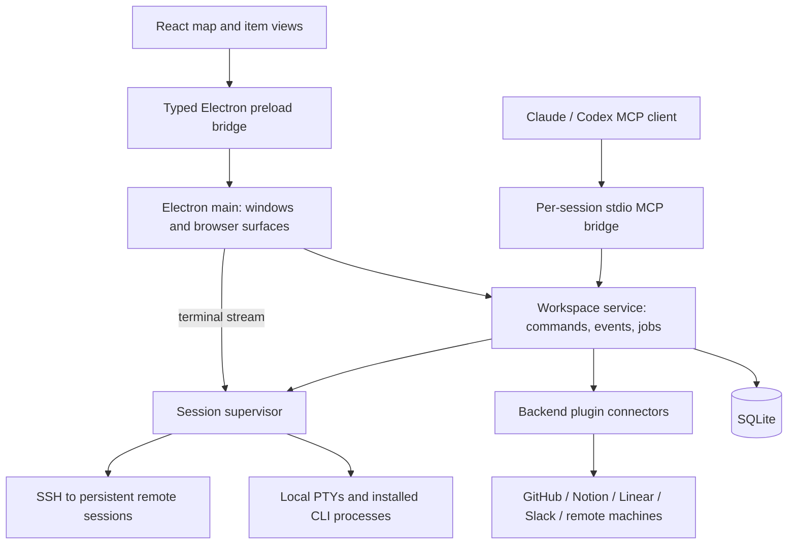

# Agentic Crafting Table — application architecture

Status: desktop, shared commands, SQLite and local service implemented. See the
[product specification](specification.md) for required behavior. Existing modules
include reusable scaffolding; provider and session adapters below remain planned.

## 1. Decisions

| Decision | Choice | Reason / consequence |
| --- | --- | --- |
| Desktop shell | Electron; macOS first, Linux supported, Windows early | Real terminals, local credentials, browser surfaces and a consistent rendering engine. Keep Electron-specific APIs behind a narrow bridge. |
| OS behaviour | `packages/platform` | Process trees, shells, CLI lookup, local endpoints and private-file checks live behind functions there, so a new OS changes one package. It has no dependencies, because the updater helper can load it after an interrupted `npm ci`. Do not add signal, shell or socket code elsewhere. |
| UI | React + TypeScript; React Flow as the initial graph engine | Reuse pointer/edge/viewport primitives; own semantic zoom, outlines, pixel bubbles and item expansion. Validate these interactions in an early spike before committing the complete port. |
| Domain | Reuse the existing TypeScript graph, plugin and command modules | One set of rules for UI, agents and provider events. Avoid a second graph implementation. |
| Persistence | SQLite behind the workspace service | Atomic commands, migrations, provider identities, durable jobs and restart recovery on one machine. No hosted database needed initially. |
| Session display | xterm.js + node-pty | Show real installed CLI/shell processes. View lifetime is separate from process lifetime. |
| Session execution | Independent session supervisor; local first, SSH/remote-machine adapter later | Window and workspace-service restarts can reconnect to live sessions. A supervisor crash/reboot still requires recovery or native conversation resume. |
| Agent control | MCP bridge to the same workspace service | CLI processes neither edit SQLite nor duplicate business logic. |
| Integrations | Trusted backend plugin connectors and a durable job runner | Provider credentials and side effects stay outside the renderer. Polling/reconciliation supplements hooks and agent updates. |
| Initial deployment | Local app + local services | No cloud control plane, message broker, container fleet, or multi-user synchronization in the first release. |

React Flow is an implementation choice, not a requirement to adopt its default
node appearance or fit-view behavior. Preserve the reference's spatial language.
If the initial spike cannot preserve terminal focus/mounts and continuous zoom,
record the evidence and replace the graph renderer without changing the domain API.

Renderer spike result: retain React Flow 12.12.0. Real pointer/keyboard
tests verify world-position stability, project/member dragging, and xterm focus
and mount identity across item expansion. Keep controlled node dimensions alongside
positions so React Flow does not lose the centered origin during drag. Defer terminal
focus until map selection finishes. The locator uses canonical coordinates rather
than the expanded item's projected rectangle. A four-item fixture measured 9.1 ms
p95 frame intervals; large-map budgets and final interaction parity remain later work.

## 2. Process boundaries



The renderer has no Node integration, direct database access, arbitrary process
launch API, or provider tokens. Preload exposes typed, validated operations such
as read workspace, apply command, run action, subscribe, and attach terminal.
Electron main owns file dialogs, browser navigation and OS integration.

Isolated test launches (`ACT_TEST_DATA_DIR`) create hidden, non-focusable windows
and use macOS accessory activation policy so automation does not interrupt the
desktop. Background throttling is disabled only for these windows, preserving
renderer animation frames, screenshots and terminal measurements. Activation and
second-instance callbacks cannot show a test window. `ACT_TEST_SHOW_WINDOW=1`
opts into visible debugging; normal app launches keep their existing behavior.

The workspace service is the only production database writer. It can remain
running without an open window, executing watchers and receiving MCP commands.
Start one service per application data directory using an exclusive startup lock
and versioned endpoint discovery. A second app window connects to it. Schema and
plugin migrations finish before it accepts commands; supervisor synchronization
and durable-job reconciliation may continue after IPC opens. Their lifetime is
owned by service disposal, and lifecycle gates control new launches during close
or failed checkpoint recovery.

The supervisor owns PTY processes, dimensions and bounded output buffers. It does
not write graph state. It reports session events to the service and maintains
enough runtime identity to reconnect after a service restart. SQLite stores the
durable session registry; runtime processes are reconciled with it on startup.
Keep this small: no distributed scheduler is needed.

Workspace and supervisor connections own their sockets from the initial handshake
through subscription/initialization and ready state. Closing cancels the pending
socket and service-start polling, rejects setup and suppresses late ready events.
Socket closure removes its cancellation listener so reconnects cannot accumulate
listeners. Cancellation must not launch another service or stop an independently
running service/session; uncertain commands are never replayed by the transport.
Transport disconnection rejects pending calls with CONNECTION_LOST and retains the
original error as a local cause, without mutating it. The wire error projection
excludes that cause. Startup probes extract only allowlisted codes and bounded
phase/timing history, preserving the distinction between unavailable IPC and a
stalled handshake or snapshot without exporting paths or error messages.
The renderer retries its initial local graph/catalog/view/capability/settings reads
with 0.5–5 second backoff, or on reconnection, until the first successful load.
Unmount cancels retries. Later reconnects use subscriptions without reapplying the
saved startup camera or replacing drafts. This automatic retry path contains no
commands, launches or remote provider actions.

For the local services, prefer user-owned Unix-domain sockets with restrictive
permissions and a per-install authentication handshake. Do not expose an
unauthenticated localhost HTTP endpoint. The renderer receives only the narrow
Electron bridge. Remote MCP connectivity is a separate SSH-forwarded authenticated
path, not public exposure of the local service.

## 3. Code organization

Introduce a root package/workspace manifest, pinned toolchain and lockfile before
moving code. The following is a target layout, not existing directories:

```text
apps/desktop/                 Electron main, preload, React renderer
packages/core/               Existing graph and command semantics
packages/plugins/            Item packages; one manifest-driven registry (src/resource-plugins today)
packages/workspace-service/  SQLite, command dispatch, subscriptions, jobs
packages/session-runtime/    Supervisor, PTY transport, provider/SSH adapters
packages/mcp/                Discovery/resources/tools and service bridge
packages/agent-context/      Launch brief, guide, context delivery, summaries
packages/integrations/       Provider clients and cross-resource workflows
tests/e2e/                   Desktop journeys and reference fixtures
tests/fixtures/              Scripted child agent, provider responses, graphs
docs/                        Spec, architecture, testing and plugin guides
prototype/                   Frozen interaction reference
```

Move a module only when its destination builds and its tests pass. Keep pure
definitions free of React/Electron/backend imports. Adapt the existing framework-
independent view contract to React instead of making the core depend on React.
Move `WorkspaceControl` out of the MCP-owned directory so MCP becomes a transport,
not the owner of application behavior. Preserve internal compatibility identifiers.

Core extraction: `packages/core/control.ts` now owns commands and batch
reduction; `src/mcp/control.ts` is a compatibility re-export. Graph, context, plugins
and PR helpers are named npm workspace packages at their current `src/` locations.
Their eventual relocation is mechanical and is deferred until it helps a concrete
feature. `dispatch` adds validated command envelopes with atomic replay support;
legacy `apply` remains available. New view preference writes are separate from
workspace revision; the legacy `view.set` command remains compatible.

Bootstrap decision: pin development to Node 26.8.2/npm 11.19.1 and
Electron 44.4.5. Package backend entrypoints as CommonJS bundles and run background
processes with the same Electron executable using `ELECTRON_RUN_AS_NODE=1`.
The macOS packaged smoke test verified its bundled Node 24.21.0 and node-pty 1.1.0
in a separate process, including actual PTY input, resize and exit. Keep this fuse
enabled while using that runtime strategy. The service is bundled into the same
distribution, together with the separate session supervisor. Packaging is arm64 only; local bundles now receive an ad-hoc signature
(see Native desktop notifications below). Developer ID/notarization remains pending.

Session runtime foundation: the supervisor entrypoint is now bundled
and tested in that runtime. It owns a separate private `supervisor.sqlite` launch
journal, full sequenced output in its recording table, and a 256 KiB live tail.
Recordings are batched in private SQLite and read in bounded pages; legacy private
scrollback tails are imported without claiming to recover missing bytes. The logical graph remains exclusively in the
workspace database. Reused launch identities return the original process/result;
startup marks interrupted records lost. Slow socket consumers are disconnected at
the transport buffer limit. Native terminal views read incremental sequence batches
only while active, waiting for xterm consumption before the next read. Graph deletion
does not stop processes; Settings → Data & diagnostics → Sessions provides explicit Stop for orphaned items.
Journal v3 and explicit recording cleanup are described in the diagnostics and
retention section below; automatic age-based pruning remains off.

The diagnostic SessionManager is embedded in Settings; its buttons never submit
the settings form. It unmounts when collapsed, when changing settings sections or
when closing Settings, stopping its local read timer. Archive deep-links to the
archived tab of this same component. Session service/MCP identities are unchanged.
It polls the additive `sessions.page` method (`{ view: current|ended|archived,
offset, limit }` → `{ sessions, total, counts }`), which `RuntimeJournal.page`
answers with `json_extract` filters, so a poll never ships the whole journal.
`sessions.managed` / `sessionsList` keep their previous meaning for MCP, Archive
counts and tests.

Stop persists additive `stopRequestedAt` metadata in the existing journal record.
Pending launches own an abort controller; native setup closes its private transport
and process owner before returning an exited record. The shared shell PATH lookup
finishes without spawning the cancelled launch and remains usable by sibling
launches. A crash during cleanup remains honestly lost; the reserved launch ID
still prevents replay. Close drains manually stopping agents but excludes them
from a new recovery checkpoint. Plain Terminals follow their explicit startup preference. No schema or identity migration is required.

Once a session has a recording, the supervisor reconstructs its live tail directly
from the newest SQLite rows, bounded to 256 KiB/4096 chunks with whole UTF-8
characters. Cached JSON is only a compatibility copy; write failures produce one
allowlisted diagnostic code per supervisor without paths or output, and do not
interrupt the PTY after a successful durable append. Old cache-only recordings
import once and retain their partial-history marker. Deletion tombstones always
win. This does not make SQLite write failures or hardware power loss recoverable.

Terminal history reads merge durable pages with the supervisor's bounded pending
batch without forcing synchronous recording writes. The existing 200 ms/256 KiB
batch and process-exit flush remain responsible for persistence. Output bypasses
React state; only changed session metadata updates the toolbar. Polling catches up immediately, uses 16–100 ms adaptive delays during
live work, and pauses for hidden views, recording playback and fully drained ended
sessions. Resize fits coalesce to one animation-frame callback.
After live consumption, numeric diagnostics sample the remaining recorded chunks;
detected sequence gaps are counted separately. These contain no session identifiers
or text. They describe the completed read, not model progress or upstream network
health. The host never turns output silence into an automatic retry or keystroke.

A freshly mounted view (opening, renderer reload, error-boundary Reload view)
asks for at most a 2 MiB tail of the recording, enough for xterm's 10,000-line
scrollback. When more is recorded, the supervisor starts at the earliest full
reset (RIS, ED 2/3, alternate-screen switch) or line boundary inside the newest
2 MiB and prepends the private modes, alternate screen, scroll region and keypad
state left by the skipped output, so bracketed paste, mouse reporting and cursor
keys keep working. Only the restart chunk is trimmed; sequence numbers are
unchanged, so later pages and live output continue with no gap or duplicate. The
skipped prefix is scanned once per supervisor run and later remounts continue
that scan. The toolbar shows "Earlier output skipped"; the full recording stays
in SQLite. Smaller recordings replay unchanged. xterm receives output in 32 KiB
slices so a large page never becomes one uninterrupted parse.

The shared terminal surface normalizes only xterm's full-screen/mouse-reporting
wheel path. A public custom-wheel handler accumulates pixel/line/page movement,
resets stale fractions on reversal/idle/mode change and relays one line event per
step through xterm's own protocol encoder. Normal shell scrollback remains with
xterm's viewport. The TUI path emits
the first line immediately and distributes a coarse event's remaining lines over
animation frames, finishing within a 50 ms target after the last wheel event.
Reports batch into one IPC write per encoding per delivery; each source event
is bounded to a screen of lines. Small single-line events are immediate. Reverse
direction (even sub-line input), keyboard input, parsed terminal mode changes,
hidden/read-only transitions, reset and disposal cancel pending delivery. Late
frames drain the remainder instead of creating a long tail. Reduce Motion uses
the original immediate batching. The controller
uses public xterm events/options only; it never shifts pixels or rewrites output.
Native viewport smoothing remains at its default zero: enabling it reproduced a
history regression where scrolling to the bottom stopped before new output.
Both `onData` and `onBinary` are forwarded. The additive optional `encoding:
'binary'` input flag validates byte-valued strings and converts to a Buffer only
at the PTY owner, preserving legacy mouse coordinates above 127. Existing Unicode
input stays UTF-8. Disabled/read-only terminals never relay wheel input.
The supervisor supplies a missing `LANG` before both PTY spawn and native-driver
preparation: `en_US.UTF-8` on macOS, `C.UTF-8` elsewhere. It preserves explicitly
configured LANG/LC_* values and does not alter its own environment. GUI launches
otherwise leave native clipboard children such as macOS pbcopy without an encoding,
which can decode UTF-8 as MacRoman. xterm's ordinary selection copy remains its
native Unicode copy handler; no heuristic text repair or clipboard interception.
New surfaces fit synchronously before their first output/history write, then use
the coalesced resize observer. This prevents fast full-screen replay from losing
top rows in xterm's default 80×24 grid before the first animation frame.

Terminal interaction follow-up: the shared surface handles
Shift+Enter through xterm's public custom-key hook. Agent views send CSI-u
Shift+Enter so the native CLI interprets its multiline key. Plain shells with
bracketed-paste support receive a literal newline through `paste`; others receive
the distinct key, never an indistinguishable plain submit key. Input is still routed through the existing
channel and its stopped/read-only gate. Composition and other modifier combinations
retain native handling.
The pinned official `@xterm/addon-web-links` 0.12.0 recognizes printed/wrapped URLs;
xterm's OSC 8 handler shares the same activation policy. A portal menu displays
the destination and offers native clipboard copy or the existing browser opener.
Both main-process IPC endpoints verify the caller and share bounded HTTP(S)
validation. No clipboard reading, automatic external navigation or custom URL
parsing/detection engine is added. Screen-level link gestures suppress native TUI
mouse reports, while Shift-drag and normal text selection remain available.
Menu lifetime follows surface visibility; history/stopped output remains navigable.
See [xterm link handling](https://xtermjs.org/docs/guides/link-handling/) and
[Claude multiline input](https://code.claude.com/docs/en/terminal-config).

Visible terminal surfaces load the official
[`@xterm/addon-webgl`](https://github.com/xtermjs/xterm.js/tree/6.0.0/addons/addon-webgl) 0.19.0 alongside
xterm 6.0.0 after `open()`. Chromium selects the supported WebGL2 backend without
GPU/blocklist overrides. Initialization failure or the addon's context-loss
notification disposes it and restores xterm's DOM renderer for that surface's
lifetime. Hidden surfaces dispose the addon and recreate it when shown, keeping
the original Terminal, buffer and PTY. The same policy covers agents, shells and
recordings. `data-terminal-renderer` identifies the selected renderer for local
inspection and regression evidence without storing terminal content.

`packages/diagnostics/performance.ts` stores at most 512 numeric samples per fixed
metric plus aggregate counters. The renderer adds foreground frame/long-task
observation and timings at the terminal boundaries. Settings exposes reset and a
JSON download; reports contain no session IDs, directories, input or output text.
Read/write timings include IPC/parsing completion, not guaranteed compositor paint
completion. End-to-end synthetic echo tests separately measure visible response.

Native Codex: the provider registry selects Claude or Codex while
retaining shared creation, jobs, views and recovery. Dynamic plugin field options
expose the native model catalog through the same service/desktop/MCP operation.
Codex uses a private per-session Unix WebSocket server plus its real CLI terminal;
the supervisor journals the returned identity before appending a versioned developer
guide and separate project-reference message. No task is submitted for general
session creation. The observer unsubscribes before the native terminal resumes the
persisted conversation, so native prompts and approvals stay with the terminal.
Global status notifications update runtime metadata; the service reconciles it into
the graph without rewriting unchanged summaries or lifecycle state. Stop closes
both the terminal and server/tool processes. Native user configuration is preserved;
per-session MCP overrides are literal argv/config data. The native transport is
experimental and capability-gated; release crash/recovery hardening remains tracked.

## 4. Persistence and command contract

Project skill actions use the provider registry's native metadata and invocation
adapters. The backend resolves skills in the project/override folder, then freezes
the selected workflow into the existing agent launch plan and durable job. Skill
runs introduce no second runtime or renderer-owned execution rules. UI and MCP share
discovery, validation, collision-aware item placement and idempotent launch handling.
Native resume continues the run without replaying its initial skill invocation.

Implemented foundation: `packages/workspace-service/sqlite-store.ts` uses the
built-in Node SQLite driver, foreign keys, WAL and full synchronous commits. Schema
v1 stores graph records; v2 adds receipts, event cursors, views, imports and jobs;
v3 adds atomic service ownership with a stale-process check; v4 persists native
hook ordering separately from graph revisions. Repeated tool observations cannot
invalidate an agent's MCP read→write sequence. Only changed status is published.
Events are durable change notifications; consumers can fetch a consistent snapshot
with its cursor. Trusted connectors supply normalized provider identity keys to
the unique index; unavailable plugins retain existing keys. The service connects
this store to authenticated local clients. Subscribers receive consistent full
snapshots with monotonic cursors and reconnect after service loss; the transport
never silently replays an uncertain mutation. The local Claude adapter is connected;
remote provider adapters remain later work. See [native Claude](native-claude.md).

The initial SQLite model contains the following logical records. Plugin payloads
remain versioned JSON; index stable identity and relationship columns separately.

| Record | Important fields / invariant |
| --- | --- |
| Workspace metadata | Schema version, monotonic revision, update timestamp |
| Projects and map nodes | ID, project/resource reference, world position, user title/summary, archive/done state |
| Resources | ID, plugin/schema version, connection ID, validated payload; unique provider identity per connection |
| Links | Endpoint IDs, reference/context kind, label; no dangling endpoints |
| To-dos | Text, completion, attached node IDs; map to-dos remain resource-backed |
| Connections/workspaces | Provider account references and local/remote workspace identities; no raw credentials |
| Sessions | Provider/native session identity, supervisor identity, workspace/cwd/model, launch snapshot, guide version delivered |
| Observations/attention | Provider status/revision/time, attention reasons, per-account assignment/view cycle |
| Jobs | Action, request key, state, attempts, correlation IDs, result/error, retry time |
| Events/outbox | Committed sequence, command/job identity, event payload for subscriptions and reliable scheduling |
| View preferences | Camera, selection, to-do position; scoped to the local view/window |

Commands use an envelope with `commandId`, `expectedRevision`, actor, and a
validated payload. Existing command semantics remain authoritative. Apply command,
invariants, revision increment, result and outgoing event in one transaction.
Publish only after commit. Repeating the same command ID returns its saved result;
reusing it with a different payload is rejected. A stale revision returns a typed
conflict with the current revision and does not partially mutate state.

External I/O never runs while holding a SQLite transaction. Create a durable job,
commit, then invoke the connector/runtime. Persist the external identity before
claiming completion. Job states include queued, running, waiting, succeeded,
failed, cancelled and outcome-unknown. Recovery reconciles outcome-unknown actions
before retrying; an idempotency key in our database cannot guarantee exactly-once
behavior at a provider that does not support it.

Subscriptions deliver ordered revision/sequence events with a resume cursor.
Clients ignore duplicates, detect gaps and reload a snapshot if history has been
compacted. Cursor and snapshot revision must agree. Graph changes and provider
observations use the same validation path; an observation cannot overwrite user
layout or lifecycle. High-volume PTY bytes bypass the graph event log.

Keep optimistic movement in the renderer during drag; commit an atomic final move
(including project members/collision displacement) on drop. Rebase or visibly
revert on conflict. Store camera updates separately so panning does not create
spurious conflicts with an agent adding a PR.

Import existing JSON state with an explicit, repeatable migration that preserves
IDs and reports incompatible records. Keep a backup before schema upgrades and
test recovery. Do not silently reset an unreadable database or missing plugin data.

Local macOS builds are staged separately from the installed bundle. The installer
smoke-tests that exact stage, rejects running app/service processes, and swaps only
`Contents` while preserving the outer `.app` directory's identity. Dock bookmarks
follow directory identity across renames; moving the whole app into a backup can
silently redirect the user's shortcut to an older, schema-incompatible build.
Previous contents are retained outside a launchable top-level `.app`, with rollback
if activation fails. No installation step modifies the workspace database.
Sequential streamed SHA-256 inventories compare all Contents paths, file bytes/modes
and literal symlink targets without following links. Capture the source inventory
before smoke verification and compare it again afterward. Before activation, compare
the private copied bundle against that same inventory and recheck process guards.
A changed source/copy fails with `INSTALL_CHANGED` before the installed Contents
move, and normal journal recovery discards only the owned staging copy. Rebuilding
the source after copying cannot alter the independently verified private copy. Equal
bundles return an unchanged result after rechecking the process and app identities.
Changed bundles check destination `statfs.bavail` against block-rounded payloads,
one metadata block per entry and a 16 MiB margin before staging. Recovery still
runs first; disk estimates cannot guarantee against concurrent external writes.
The installer never prunes historical rollback builds automatically.

## 5. Map rendering and plugin views

Map nodes carry optional legacy `mapSize` tiers and custom `mapDimensions`.
Plugin `mapSizes` metadata declares supported content tiers, native dimensions,
default tier and bounded detail (summary lines, public field keys, field lines,
type/icon treatment). Registry validation and serialized discovery expose this to
UI and MCP. `item-map-sizes.ts` resolves dimensions using revisioned `itemMapSizes`
preferences, keyed by the same per-type/provider profiles as expanded views. Custom
dimensions override preset dimensions and choose the largest fitting content tier;
legacy choices and missing metadata retain their existing defaults. Installing a
plugin needs no map or transport branch. See [item-map-sizes.md](item-map-sizes.md).

All footprint, creation, move, resize, restore and repair paths receive these
preferences. `node.resize` accepts either bounded dimensions with an optional
center or a legacy tier, never both. Legacy tier changes clear the custom override.
The shared `resizeItem` validates plugin-derived limits and uses `moveItems` for
collision displacement. The renderer uses the same function for transient layout,
retains it until the command settles, and reverts on failure/cancellation. One
command commits dimensions and affected positions with revision/replay protection.

The bottom-right pixel grip captures the pointer and converts screen deltas through
camera zoom and semantic detail interpolation, adjusting the center to pin the
visible top-left. Pointer release saves; Escape, pointer cancellation, lost capture
or blur cancels. Arrow keys use the same command. Other drags and camera gestures
are suppressed while resizing. Edges and neighborhood fields use the transient
footprints without mounting item detail views or restarting processes. Completed,
project-title, tiny overview and expanded projections have no grip.

The optional node field fits the existing JSON persistence: no database migration
or startup layout rewrite is needed. Old unsupported tiers still resolve to the
native default without deleting data. Settings retain supported preset dimensions,
default selection and reset; single-tier types expose their one footprint. User
preferences override dimensions/defaults, not plugin capabilities or content policy.
Settings saves commit preferences, growth-related position repair, graph revision
and event in one SQLite transaction. Both settings and graph snapshots reach
subscribed renderers; UI/MCP writes read preferences inside their store transaction.
The renderer shows bounded saved text, never provider fetches; note excerpts are
capped before rendering. Expanded-view preferences and session mounts remain
independent. Right-click menus contain no size controls.

Plugin appearance may declare `completedIcon`. Done never changes an item's
footprint, opacity or link visibility; the map strikes through its title, and map
and to-do attachments resolve its icon from the node's `completedAt` (aliases can differ).
`completionToggle` turns the map card's type icon into a checkbox control that runs
the same `node.complete`/`node.reopen` commands as the context menu (to-dos opt in).
A snapshot's `done` mirrors provider completion onto `completedAt` when it changes,
and a connector action marked `completion` is run by the service after a person's
`node.complete`/`node.reopen` (UI or MCP `apply`); failure reverts the local change.
To-dos declare these capabilities and expose no editable payload fields. Retired
v1 notes stay valid stored data, but are omitted from presentation and context;
there is no destructive migration or provider-specific map/MCP branch.

The renderer consumes service snapshots and events, then derives visible nodes,
rollups, membership lines, outlines and to-do groups through shared pure functions.
No production sample-state branch and no copied prototype business rules.

Maintain one coordinate space. Semantic detail interpolates around anchored node
centers. Outline geometry reserves detailed card footprints and updates on graph
edits, not on every camera tick. Collision resolution runs on creation and movement
commands and returns a deterministic set of position changes. Focus expansion uses a bounded screen-space projection with visible map margins
and preserves the stored positions used when returning to the map. Plugin `view`
metadata declares inline/card/focus behavior, defaults and optional provider
variants. Shared `itemViewProfiles` resolves stable per-type settings keys (agent
variants use `agent.session:claude`/`:codex`). `itemViews` is a validated size record
in existing revisioned settings; absent keys inherit plugin defaults, including
unknown/uninstalled types retaining their preferences. No SQLite migration or
identity rewrite is needed. Notes clamp near their original screen center; focus
surfaces center in the available canvas, with width/height clamped on resize.
Inline types never mount detail even when reached from connected-item navigation.
Settings navigation is a renderer-only tree with root sections and plugin-derived
item-profile leaves. New item shortcuts live on the Items parent page, using
the same parent-owned quick-choice draft. Stable escaped page IDs connect tree entries to labelled
regions. Hidden pages remain mounted so local account/shortcut drafts survive
navigation; a single parent-owned revisioned draft still owns Save/Cancel.
Tree expansion/focus are local UI state, separate from selection. Native invalid
fields reveal their owning page and expand Items before receiving focus.

Changing dimensions updates the mounted surface rather than its resource identity,
so terminal resize uses the existing observer without a PTY restart.

`src/graph/project-neighborhoods.ts` derives the logical enclosures and status
counts. Outlines follow the convex hull of detailed member corners, expanded in
all directions by the configured clearance (240 world pixels by default). This
forms a rounded envelope along diagonal/elongated groups without the unused sides
of a circumcircle. A circumscribed 32-sided padding disk preserves minimum
clearance between arc samples (less than 0.5% excess). Rasterization takes both
extrema of every horizontal strip and rounds outward onto a group-local square
grid. At most 128 rows / 512 vertices bound SVG complexity independently of spread;
translation preserves the contour, including its pixel steps. The interior is one
filled enclosure without holes or connecting corridors. Only visible member
footprints determine it; the project's saved anchor is a
fallback for an empty project. Member drag previews update these same bounds live.
`src/graph/neighborhood-fill.ts` samples that logical enclosure onto a stable
world grid, producing four SVG paths of horizontally and vertically merged
rectangles with fading shades and optional
deterministic scattering. No visible stroke is painted. Overall SVG opacity is applied once so
overlapping project interiors cannot accumulate brightness. The renderer memoizes
those paths by enclosure coordinates and appearance, independently of the camera.
At most 16,384 candidate cells and 512 cells per axis bound work for extreme
spreads; coarsening uses an integer multiple of the requested pixel size. The
original transparent geometry path retains membership, attachment and measurement
semantics; visual gaps never remove ownership. The map uses the actual field in
expanded views, replacing the separate focus frame. Attachment highlights change
the field tint. Short geometry/shade transitions skip dragging and reduced motion;
no animation runs while idle. Revisioned `neighborhoodAppearance` settings are
additive, share UI/MCP validation and require no database migration.

Biomes (BIOME-01) paint the same sampled cells. `neighborhoodCells` returns one
shade per world-grid cell and `neighborhoodPaths` merges them into the four SVG
paths, so the plain field and a biome's ground share one sampling per enclosure.
`src/graph/biomes.ts` is pure: a table of ten biomes keyed by preset color (ground
function, flat color, growth sprites), a coordinate hash, `biomeGrowth` (which
cells grow what, clear of item footprints) and painters that write RGBA pixels
into a buffer, six detail units per cell. It has no DOM dependency and no branch on
item type. `NeighborhoodCache` keeps each project's member footprints beside its
enclosure; their identity changes only when that project's members move.
`BiomeGround` (`apps/desktop/renderer/neighborhood-field.tsx`) puts the buffer into
one `<canvas>` per project inside a `.neighborhood-biomes` layer that lies under the
field SVG in the viewport portal and carries one layer opacity. The canvas is sized
in world pixels and scaled by the viewport transform with `image-rendering:
pixelated`, so pan and zoom are compositor work only. The ground is memoized by
enclosure, appearance, biome and texture; growth is stamped on a copy and the
canvas is rewritten only when the set of grown cells changes, so a drag does not
repaint for frames in which the item crosses no cell. While detail is under one
device pixel the layer hides its canvases and draws the flat color from the same
four paths. With **Plain colour**, a custom color, a muted project or the Undermap
there is no biome layer for that field and the SVG is the former markup unchanged.
`ACT_TEST_NEIGHBORHOOD_STYLE` pins the drawn style in test launches only; it
reaches the renderer in the page address and never changes saved settings.

The `appearance` setting (SETTINGS-APPEARANCE) becomes Electron's
`nativeTheme.themeSource` in main (`apps/desktop/appearance.ts`), which also picks the
window's pre-paint fill. Main passes the resulting light or dark to the page in its
address and over IPC on every change; the renderer sets it as `data-theme` on `<html>`
and never reads `prefers-color-scheme`, which Playwright emulates as light. CSS picks it
up through the light block of `tokens.css`, and canvas or prop colours that cannot read
tokens (xterm, its search decorations, React Flow's arrowhead and dot grid) through
`useColorScheme()` in `color-scheme.ts`.

Overview and neighborhood use the same draggable title above the outline; there
is no central project bubble. The locator uses the derived center. Neither
projection rewrites saved positions. Switching zoom levels never changes
the outline. Shared settings supply the padding;
older JSON settings default it without a database version change or data reset.
Desktop subscriptions apply revisioned UI/MCP setting updates immediately. The renderer memoizes geometry independently of the
camera and records `map.geometry` timing. Camera-only projections preserve each
unchanged React Flow node identity, event callback identity and detail-renderer
identity so panning does not rerender all cards or reroute all edges. Reuse card
data independently of wrapper position and memoize the card itself, so moving
viewport-pinned project labels does not repaint their unchanged content. Semantic
zoom still updates dimensions. Separate map frame/long-task/card-render metrics
and 200/500-item workloads enforce the performance budgets. Labels use an inverse-zoom projection
for readable text, sit behind members, and follow the visible top edge when the
outline extends offscreen, including the overview title when its cap is clipped.
Neighborhood titles and their text are centered above the outline, sharing the
overview title placement. Only a clipped title is pinned to the viewport edge.
Outlines paint beneath labels and links; a viewport-pinned title has opaque text
backing when the outline passes underneath it. A label drag converts its projected delta back to the
project's saved anchor before issuing the shared move command. The outline expresses project membership at every zoom, without derived lines
to a central project bubble. Explicit item edges use the direct renderer. It observes
only its endpoint nodes, clips a straight center-to-center segment to their actual
projected dimensions, and retains BaseEdge's wide pointer target and directed
context marker. Pan does not recalculate world endpoints; drag, completion and
semantic zoom update them. Coincident/overlapping bounds with no exposed segment
render no reversed arrow. This is view geometry and never rewrites stored links.

Pointer inspection is separate from keyboard focus: pointer movement/down clears
keyboard emphasis, pointer exit clears hover, and native window blur clears both.
Hover/focus changes only visual emphasis and connector/grip visibility, never card
geometry or content. Direct edges meet the actual projected bounds. No plugin
detail/terminal view mounts on hover. Editable-title items route activation to
their inline editor, including from compact overview.

A transparent sibling backdrop beneath the creation ring owns pointer hit testing
across the workspace, including gaps between choices. Native pointer exit and focus
transfer clear map inspection; the dismissal event cannot fall through to an item.
The backdrop exists only while picking a type, with the existing outside-click and
right-click layer handlers owning dismissal.

The creation ring uses the plugin catalog filtered by project context (no nested
Project choice), preserving saved quick-choice IDs. All is omitted when only
Project or nothing remains outside the quick choices. The amber, dashed blank center supplies the
screen bounds for the same compositor expansion into a measured inline form.
Pointer/keyboard inspection temporarily presents a miniature type using shared
ItemChoice icon/brand/tone/size metadata. Only local center dimensions/colors and
its short label animate; no plugin view mounts or provider/runtime calls occur.
Initial focus and All leave the draft blank; exit/layer changes clear the preview.
Type selection captures the visible seed, even during its bounded transition.
Center and clamp that form before paint; overlay movement never changes the original
world placement. Back/right-click/Escape returns to the ring, then closes it.
On opening, bounded Web Animations grow the center (180 ms) and spread choices
from it (280 ms, 60 ms initial delay plus 12 ms per choice). Final absolute
positions stay fixed; only transforms/opacity animate. Layer changes restart
choice entry without recreating the center. Unmount/reduced-motion changes cancel
animations and leave the static final CSS layout, with no graph mutations.

Keyboard opening, 10-pixel movement (100 with Shift), Shift-F10 item options and
Escape navigation share the pointer paths. Native terminal and form input keep
their own keys. New project uses the map's right-click menu and original world
placement, passing through the existing shared collision-free creation command.
`src/graph/movement.ts` is shared by live drag previews and `node.move`/`nodes.move`
commands. Capture the grab point on pointer-down, before React Flow's threshold,
then convert pointer deltas into world positions; this also handles projected
project titles. Requested items and translated project members stay fixed. Reserve
unobstructed neighbors first, then place displaced cards at deterministic clear
edges with 20 world pixels of spacing, using plugin-defined detailed footprints.
Archived items/descendants and populated project anchors are not obstacles;
empty projects reserve their anchor footprint. Whole-project movement still
translates archived members. A batch that requests overlapping held positions or
conflicting member offsets is rejected atomically. For an older project with
existing internal overlaps, group translation preserves its offsets; moving a
member separately repairs the layout. The explicit `layout.repair` command first
reserves already-clear visible footprints, then deterministically separates the
overlapping group. Settings → Map and MCP share this command; archives, resource
identities, links, statuses and camera remain intact. No automatic startup/zoom
rearrangement.
Keep the preview until the command settles; the service commits the held and
displaced positions in one revision. A failed/stale command visibly reverts and
reports its error. Resources and links do not change. Ordinary movement preserves
membership; an explicit cross-project drop batches attachment before placement. Placement
timings use `map.placement`; camera-only changes do not run this resolver.

Map cards remain canonical React Flow nodes at every focus level. Their positions,
footprints, edge endpoints and neighborhood geometry do not depend on an expanded
view. Opening adds a screen-space sibling surface keyed by node ID, retaining each
visited plugin/terminal mount while inactive. Map cards use `data-item-id`; detail
surfaces use `data-expanded-item-id` and a distinct accessible region. The native
terminal toolbar resolves the detail surface's toolbar slot. Its non-interactive
metadata and empty space share the heading's independent-view drag handling;
exclude actual controls, not the whole toolbar slot.

The mark on a card's bottom edge (VIS-03) is one pointer-transparent `.working-mark` span
inside the card. `leadPose` in `grazing.ts` decides from plain node state whether a card has
one and what its own sheep does; `markLabel` words it; `meadow` lays out the edge in px:
flowers at the right end, then one paddock (`i`) per sheep, the first the item's own, with a
pen when the node says so. A paddock's `::before` is the grass, a tiled pixel mask in the
card's own colour with the bite cut out by `mask-composite`; its `::after` is the sheep.
The first paddock holds a `u` whose pseudo-elements draw a posed sheep's head and what the
pose adds (gate, block, wool, fence); `b` elements are the pinwheel, the flowers and the
sheep that walks in or out. Stepped CSS animations on each paddock drive registered custom
properties (`--graze-x`, `--graze-face`, `--graze-leg`, and `--graze-beat` for poses) that
the pseudo-elements read; nothing is animated from script. All sprites are pixel rows in
`grazing.ts`, turned into mask images once and set on the map area. A moment is a one-shot
animation on the mark whose delay is the time it happened; each new one takes the other of
two identical keyframe names so that it plays again, and one older than two seconds when
the card renders is not played. A layout read when a marked card renders (`freeAboveEdge`)
drops the sheep for a glint where the card's content reaches into its 8 px band and hides
what rises above it where the content comes within 12 px, written straight to the mark
without React state. Expanded surfaces never mount the mark; the background map pauses
while a full item view is open; reduced motion and Undermap disable every animation and
show resting frames.

The node state comes from the service (AGENT-07e). `agent-background.ts` keeps one row per
Claude process: outstanding background tasks, teammate and foreground-helper signals, the
main thread's shell commands as one stretch, compaction, the task list, the model and the
worktree flag. `agentScene` in `agent-scene.ts` turns that row and the node's own status
into pose, helper count, waiting, `beside`, tasks, bell and pen; `sceneChanges` returns
only what differs, adding a moment when the helper count moves or a tool failed or was
denied. `AgentCoordinator.hook` applies it with the status change of the same hook where
there is one, otherwise as one `node.update`, and `settleQuiet` repeats it every few
seconds for sessions it has a row for. Eight hooks are recorded without touching the
item's status (`NOTED`). `reduceCommands` removes a pose its activity and attention no
longer allow, `helpers` from a node that is not working, `waiting` without helpers, and
the decorations of an ended session.

Opening captures the actual map bubble's screen bounds; closing captures the
current (possibly dragged) detail bounds and projects back to the map bubble.
`useBubbleMotion` animates the detail surface using compositor transforms. Content
lays out at its destination size, avoiding per-frame terminal fits and graph work.
The camera stays fixed; interrupted transitions start from the visible bounds and
reduced motion settles immediately. The closing surface hides only after its
animation finishes. Original bubbles and edges remain rendered throughout.

Expanded-heading drag uses captured screen deltas after the normal threshold,
local per-item view positions and `clampItemViewPosition`. It never invokes graph
placement, drop, attach or persistence commands. Escape/cancel/lost capture/blur
restores the previous local position. Keyboard arrows use the same bounds;
window/settings resize reclamps the view. Positions last for this renderer's
lifetime. Compact linked-item icons in the location trail still derive from graph
edges and plugin presentation rather than provider-specific branches.
Stable card-data identities let the view wrapper move without rerendering its
content or the map cards; hidden visited content also remains memoized.

The same captured view gesture handles bottom-right resizing, with per-node
width/height overrides kept beside transient view positions. `clampItemViewSize`
applies generic card/focus minimums, the card's 75% canvas policy and available
space from its fixed corner. Projection reclamps a preferred size without erasing
it on window shrink; resetting removes only that instance's override. No settings,
resource or graph command is emitted. Pointer cancellation restores both prior
position and size. The grip retains pointer capture so double-click reset and
keyboard sizing work normally. Native xterm's existing ResizeObserver coalesces
fits; a narrow view header wraps controls independently of terminal content.

Keep an expanded terminal component mounted while changing camera and selection
where feasible. Detaching its view releases subscriptions, not the PTY. Exactly
one focused terminal receives keyboard input; a hidden view must never consume it.
Use measured container dimensions to forward resize events with throttling.

Definitions drive the inline item picker, node appearance, relationship validation,
generic forms and MCP schema discovery. Client views own item contents; backend
connectors own provider reads/actions/context. The host owns navigation, process
lifetime, user lifecycle and action scheduling. Missing views use a generic view;
missing plugins render preserved unavailable records. Explicit synchronous data
migration chains run in the service under its writer lease before it accepts
commands. Each plugin's full record batch validates before a private SQLite backup
and atomic replacement; any failure preserves its original data and exposes an
unavailable reason. IDs, account bindings, links, layout, camera and jobs stay
unchanged. Missing paths and downgrades never rewrite data. Definitions and
connectors join the shared contract harness; executable migration callbacks never
appear in renderer/MCP metadata. Initially load only trusted code.

The local `workspace.note` plugin stores its plain-text body in `data.text` using
the existing resource table, schema validation and `item.add`/`item.update` commands.
No database migration or transport branch is needed. Its provider-free connector
returns local content/context; its client view uses text nodes and the optional
host `editResource` service to open the shared movable editor. Multiline fields
can declare a bounded preferred row count. Edit forms retain their original
resource snapshot and reject saves after an external resource change, preserving
the user's draft; command revisions still protect concurrent saves. For text-first
items only the data/schema identity is guarded, so an automatic title does not
invalidate a text draft. `generatedTitle.field` declares the required source field.
The shared registry permits a missing creation title only for these types, derives
a local label, and body updates refresh it atomically for every map alias. The
backend ItemTitles coordinator requests Haiku through the existing isolated
tool-free adapter, reserves the shared durable summary allowance before dispatch,
and applies results through ordinary revisioned commands after checking current
data/title/lifecycle. No graph or MCP transport branches select a Note provider.
The `tiny` appearance category uses a 144×32 detailed footprint; `openFromIcon`
exposes a keyboard-accessible icon button while the rest of the bubble still drags.

### Plugin packages and host extension points

Item types are plugin packages (`act-plugin.json` plus definitions, service and
renderer entries) registered through one `PluginPackageRegistry`; the contract is
`packages/plugin-sdk` (API 1.0.0). Bundled packages are listed once in
`src/resource-plugins/bundled/plugins.json`; `scripts/bundled-plugins.mjs`
generates the per-process entry lists, so the service bundle never imports
renderer code and vice versa. Composition happens in three places, each generic:

- Shared: `createPluginPackageRegistry()` validates manifests, namespaces and
  manifest-to-module consistency and feeds the type registry, contributed menus
  and settings sections. `packages/core/runtime.ts`, the MCP server and the agent
  guide read declarations from it (operations with agent policies, MCP tools,
  guide snippets).
- Service: `ServicePluginRuntime` activates each package's `activate(ServiceHost)`.
  Connectors, action contributions and presentation hooks land on the
  `ResourcePluginHost`; account types on `ProviderConnections`; runtime operation
  handlers in the table `runtime.run` dispatches from (host operations register
  there too). `onWorkspace` hands trusted `WorkspaceServices` (store, control,
  resources, terminals, `plugin_records` storage, broadcast, lifecycle gate) to a
  package once the workspace exists; its lifecycle hooks run at the host's
  observe/start/pause/close points.
- Renderer: `createResourceViews` activates each `activate(RendererHost)`; view
  contributions reach target views as `services.viewContributions`. Package
  stylesheets are bundled through the generated stylesheet list.

Per-package settings live under `settings.plugins[<package id>]`, declared as
`ResourceFields` on an item type's settings page. Saving validates installed
packages and keeps values of packages that are not installed. Schema 20 marks
settings saved before package settings existed; `migrateSettingsDefaults` then
applies each package's earlier behaviour once (Show/Ship on), so existing installs
keep working while new ones start neutral. Values that suit one team or tool, such
as a particular `/review` workflow contract, come from a plugin pack as a settings
preset (API 1.1; since 1.2 applied once to every workspace, only to settings still at
their defaults) instead of from the app.

Remaining host knowledge: the review engine coordinators (direct reviews, findings,
architecture preparation, /review watching) are host services whose operations
use the same registry; GitHub stays the host's account type because the inbox and
assignments use it; the PR conversation filter and Claude/Codex launch settings
keep their established settings keys and pages.

### Base app and plugin packs

The repository is the base: host, SDK, generic item types and neutral defaults.
Item types, account types, guide text and defaults for a particular team or tool
live in plugin packs, in their own repositories, built against the SDK and
installed per machine through the loader below. A pack that takes over a
type the app used to bundle lists the saved identifiers in `legacyIds`; the host
never rewrites persisted ids. Until the pack is installed, those items are
placeholders that keep their data, links and layout. A pack may also supply
values for another package's settings as a settings preset (API 1.1), so the base
ships only neutral values.

### Installed plugin packages

`packages/workspace-service/plugin-store.ts` fetches git releases with the user's
git into `<data>/plugins/repos/` (bare cache) and `<data>/plugins/store/<id>/<commit>/`
(verified release), and records approvals in the `plugin_lock` table (schema 21),
apart from the settings document. At startup the service loads enabled builds
(`plugin-loader.ts`: integrity, manifest, API range, definitions import) before
building `WorkspaceControl`, and `useInstalledPackages` makes every
`createPluginPackageRegistry()` in the process include them, so runtime
declarations, MCP tools, guide text, settings sections and menus need no second
path. `ServicePluginRuntime.activateIsolated` activates their service code with
held-back registrations, a timeout and a `PluginBreaker` around every callback;
a failure withdraws the package's types from the registry with a placeholder reason.
The MCP bridge asks the service for the loaded builds (`plugins.loaded`) and loads
their definitions itself. The desktop process serves window code from
`craft://app/plugins/<id>/<commit>/…` after checking each file's hash; the window
imports it alongside its first workspace read (`installed.client.ts`). Applying a
change restarts the workspace service (the supervisor keeps sessions) and reloads
the window, because Node's ESM cache cannot be evicted.

### Renderer styling and design tokens

Renderer and plugin stylesheets read every colour, font, type size, focus ring,
shadow and stacking value from the `--act-*` custom properties in
`apps/desktop/renderer/tokens.css`. `styles.css` imports the tokens and then
one stylesheet per surface from `apps/desktop/renderer/styles/`; import order is
cascade order. Plugin palettes (`--rf-*`, `--rv-*`) are aliases of the core
tokens. `design-tokens.test.ts` fails on new hex literals outside `tokens.css`
and on `outline: none` without a focus replacement. Roles and rules:
[design-tokens.md](design-tokens.md).

## 6. Native agent/session runtime

Provider adapters expose capabilities: launch, live attach, native resume, model
selection, instruction delivery, status events and optional artifacts. Probe the
installed binary/version and configured account rather than assuming identical
features across providers. Unsupported actions produce actionable errors.

A launch reserves item/session/request IDs, resolves an actual execution workspace,
builds and saves the pending prompt, and asks the supervisor to spawn the CLI with
structured arguments. Do not build a shell command by concatenating task text.
Deliver prompts through a supported native mechanism and record confirmed delivery.
Register the MCP server with session-scoped bindings and existing CLI configuration
without overwriting unrelated user settings. Local launch and remote launch use
the same job/result contract.

The supervisor deduplicates launch IDs, streams output with sequence numbers,
supports input/resize/explicit stop, and records exits. Reattach sends a bounded
buffer plus subsequent events without gaps or duplicated bytes. A slow renderer
cannot cause unbounded memory buffering. The supervisor recording table keeps full
output separately from the graph database; bounded read pages feed live views and
restoration of ordinary scrollback. There is no History/playback control. Explicit Stop captures a display boundary before native
CLI teardown can clear the screen. Settings and MCP provide explicit stopped-only
recording deletion; keep all recordings by default.

Live process inventory, not an old `transport` flag, decides whether to reattach.
A dropped UI transport must never cause a duplicate CLI launch. If the process
ended, resolve the complete native identity and invoke native resume. Guide/context
delivery is queued only at a confirmed provider-supported boundary. A provider
without that capability exposes pending context for explicit use rather than
guessing by typing into its terminal.

The agent Session menu invokes `workspace_run` / `runtime.run` action
`agent.context.inject` with a process-bound request ID. The service verifies an
active managed Claude process, journals a durable guide request and resolves the
current project/links at the next `UserPromptSubmit`/`SessionStart` hook (or explicit
agent context read). The trusted versioned guide stays separate from JSON reference
facts in Claude's documented `additionalContext` output. An `agent.context.ack`
receipt confirms the exact offered snapshot, then completes the guide request;
preparing or emitting an offer alone never claims acknowledgement. Unacknowledged
requests remain retryable, and an old process's request cannot target a replacement.
The renderer only manages menu state and observes delivery; no PTY typing,
paid model call, native settings rewrite or replacement system prompt is involved.
See the provider's [hook reference](https://code.claude.com/docs/en/hooks#userpromptsubmit).

Context offers now include a shared, deterministic hierarchy: the current project,
its active members, and their explicitly connected subitems. Floating agents use
their connected component. Resource aliases collapse; archived items and archived
projects are excluded; done items retain their state. Plugin `context.parentField`
metadata orders results beneath their source (for example a review beneath a PR),
but only while a real link exists. Parent/depth describes display order; original
directed links remain available separately. Reference relationships are background,
not permission to act. Another project's implicit membership is never traversed.
The existing `sources` field still identifies direct incoming context links.

The service reads plugin context with at most six concurrent requests and one
three-second deadline. It limits the inventory to 200 items and inline content to
700 characters per item / 32,000 total, exposing omissions, truncation and missing
content. Summary-only review entries carry safe revision metadata; actual findings
are available through explicit read-only session/resource actions. Credentials and
raw terminal recordings are never copied wholesale into the opening offer. A
revision change during reads recomputes the snapshot; acknowledgement checks its
fingerprint, including nested links and item state.

For a new general-purpose Claude session, the adapter supplies a host-authored
native initial prompt asking for a short, grounded What next list, then a pause
for the user's choice. Current facts arrive separately through the existing
SessionStart hook/MCP offer. Explicit task and skill prompts take precedence;
resume/import, live attachment and startup recovery do not repeat orientation.
The frozen launch plan keeps retries identical. This is an ordinary Claude turn,
not a second summarizer process or a renderer-generated conversation.

Claude settings include default-on `autoMode`, added through schema defaults when
reading older settings without changing their revision or other preferences. A
shared pure permission-argument helper resolves explicit split/inline overrides
before the boolean default, and the adapter emits exactly one permission-mode flag.
Off selects native `default`; changing the UI toggle removes only permission-mode
overrides. The CLI help probe checks its advertised auto choice and reports missing
support before launching. New/resumed processes receive current preferences while
frozen retries and live processes stay unchanged. Independent restricted review
launches do not inherit this general-purpose preference. Native user/admin policy
still controls Claude's actual permissions; no global Claude settings are rewritten.

Use documented hooks/events when available to report activity. Correlate every
event to the actual session; stale events cannot overwrite newer state. If reliable
signals are absent, show unknown/idle honestly. Activity summaries run separately
with bounded input, explicit settings and a fallback; they cannot control the CLI.

Quit, application updates and (outside macOS) window close share a confirmation
and shutdown path. On macOS the window `close` event is prevented and the window
is hidden through `window-presence.ts`; the Dock `activate`, `second-instance`,
notification click and Window-menu item reveal that same BrowserWindow, so the
renderer keeps its document and production `backgroundThrottling` pauses its
rendering while hidden. The main process reads the persisted `warnBeforeClosing` preference on every quit;
missing settings or failed reads retain the warning. Disabling it skips only the
confirmation dialog, never checkpointing, process draining or close errors. The
workspace service first drains accepted launches, then commits a SQLite recovery
checkpoint with stable session/node/native identities and fresh idempotent resume
request IDs. It blocks new launches, stops managed PTYs and their descendant tools,
and verifies exit before the desktop closes the services. Cancelling before this
boundary changes nothing. Explicitly stopped sessions are excluded from recovery.

The main process owns versioned `window-state.json` in the stable application-data
directory. It stores the normal native rectangle, display ID and maximized flag,
separately from workspace/map view state. Read/validate the bounded file before
constructing the BrowserWindow. Use Electron's device-independent bounds and
display work areas: keep valid negative coordinates, choose the display with the
greatest overlap, or the saved display/primary fallback, and fit into its usable
area. Missing/corrupt state falls back to a centered window. Move/resize/mode events
capture normal bounds; debounce small atomic file replacements by 250 ms and flush
synchronously on close. Errors are nonfatal and retryable. Minimized/full-screen
geometry never replaces the normal rectangle. Maximized restoration is skipped in
hidden tests because Electron's `maximize()` reveals the window; background tests
otherwise use the same persistence path. Real macOS Spaces/multi-monitor presentation
remains a manual acceptance check. APIs:
[normal bounds](https://www.electronjs.org/docs/latest/api/browser-window#wingetnormalbounds),
[screen work areas](https://www.electronjs.org/docs/latest/api/screen).

On startup the desktop asks the service to recover pending checkpoint entries.
Close only checkpoints sessions bound to current unarchived map items, while still
stopping all managed processes. Recovery rechecks pending and failed entries against
the current graph. Removed/replaced bindings become `skipped`, with stale errors
cleared and recordings untouched. Existing attached failures remain failed until
explicit Retry; reconciliation must not launch them. Skipped-only checkpoints have
no renderer notice, and subsequent close omits them. No database migration/reset
or recreation of missing map items is involved.
Reattach surviving processes; otherwise resume the native Claude conversation on
the original item. Plain Terminals use their opt-in last-command startup policy
below. Only agents marked
working (without pending input) at close receive a continuation prompt. Surface
per-entry errors and preserve request IDs across uncertain failures. Jobs reconcile
by durable identity; unsupported provider work remains pending, never fabricated.
SQLite schema v5 adds the recovery checkpoint without changing graph records. The
application data directory remains `agent-crafting-table` regardless of app display
name or build location. Keep the automatic pre-migration database backup. Never infer
live-process survival after supervisor death or host reboot.

The native close hooks follow Electron's [application lifecycle](https://www.electronjs.org/docs/latest/api/app#event-before-quit).
Resumed agents use Claude's documented [resume with a prompt](https://code.claude.com/docs/en/cli-reference).

Supervisor readiness does not depend on sourcing the user's login-shell profile.
Session listing, recording replay and diagnostic calls use persisted data immediately.
Only a fresh, deduplicated launch resolves the cached PATH before preparing the
native driver/PTY; Dock-launched agents retain the repaired executable environment.
Normal shutdown still drains these accepted launches before stopping processes.

Workspace-service disposal owns a single shared cleanup promise, including when
IPC shutdown arrives during startup. It cancels its supervisor connection before
waiting for pending log-policy setup, then waits for startup and background review
recovery to unwind before releasing SQLite ownership. Each startup stage checks
the closing state; stopped review recovery leaves later jobs queued. Final cleanup
removes the socket while still holding the lease, so a successor cannot lose its
new socket. Disposing this client does not stop the independent supervisor or PTYs;
normal desktop close still uses the checkpoint/stop sequence above. Requests arriving
during disposal retain their request ID and return `WORKSPACE_CLOSING`.

The session coordinator also owns one recovery promise, shared by overlapping
callers and included in its close drain. Cancellation stops before the next job
and leaves it queued. Lost launch replies persist `outcome-unknown`, preserving
the original request/session identity for supervisor reconciliation on a later
pass without requiring a service restart. Each candidate is re-read after earlier
awaits; a job already settled by another accepted request is skipped. Closing does
not stop the independent supervisor or turn an uncertain launch into a fresh one.

Lifecycle recovery owns rejection of its background checkpoint writes. Failure
before the recovery-start checkpoint launches nothing; failure during/finalizing
restore retains the durable checkpoint and reports an in-memory status error with
Retry enabled. While storage remains unavailable, the launch gate stays closed.
Retry first commits recovery-start, preserving request IDs and confirmed in-memory
results; after a service restart, the saved IDs reconcile any already accepted
process through the supervisor. A transient write failure also closes the gate,
even if the final write successfully persists its error. Reconstruction gates
an interrupted recovering phase or an open phase with an error before IPC work
can start. Startup reconciliation and assignment/workflow/summary watchers share
`allowsBackgroundWork`, which requires an open phase and an unblocked lifecycle;
it turns false immediately when close starts draining accepted work. The explicit
recovery pass can reconcile saved jobs after its durable start checkpoint, while
ordinary background work waits for recovery to finish. No retry attempts to erase
or reset the database.

## 7. Remote machine execution

Remote machines (for example from an internal provisioning service) are not part of
the base app. A plugin pack can contribute such an item type, its account type, views and
guide text through the plugin API and keep the identities saved before it existed
through `legacyIds`; without the pack those items stay as unavailable placeholders.
Remote persistent terminals and remote MCP for such machines remain open and belong
to the pack, behind the same consent and integrity checks as any installed package.

## 8. Provider content and review workflows

Provider clients handle account-scoped authentication, pagination, rate limits,
timeouts, retries and cancellation. Reconciliation upserts by provider identity,
not title or URL formatting. Commit a discovery snapshot only after all pages
succeed; preserve state on partial failure. Poll while the service runs and refresh
on reconnect. Webhooks can be added later without becoming necessary for v1.

PR review jobs capture comparison identity, fetch the complete diff (or report why
it cannot be complete), and retain the commits actually reviewed. A new head never
silently relabels old results. Direct reviews run native agents in an isolated
appropriate checkout/worktree and retain terminal plus findings. The workflow
adapter must verify repository support, correlate trigger/run/job/report, and
handle an uncertain comment POST without blindly posting again. The workflow it
watches is configured, not assumed; any required workflow edit is separate
repository work, not an app capability.

Direct review implementation: `ReviewCoordinator` freezes the source binding,
model and comparison into a durable preparation job before creating a linked
`code.review` item through shared commands. The source adapter supplies capture
and identity; the generic supervisor owns its native one-off PTY. Active reviews
deduplicate across aliases of the same source resource and comparison. Preparation
and launch IDs survive reconnect/restart; an uncertain UI reply retains its request
and model. Preparation success means the process launched, not that review finished.
Native exit/state observations update the review item separately, and the complete
terminal recording is retained. The detail view is registered by the review plugin.

Reviews use capability-probed CLI controls: Codex read-only sandbox with no approval
escalation, user config/rules or MCP; Claude restricted/safe mode with only Read,
Glob and Grep and no MCP/customizations. The launch directory is the private parent
of the frozen checkout so repository instructions are source material. The supervisor
also refuses interactive input for these one-off sessions. These controls do not
make fixture results evidence of real model behavior. Close checkpoints interrupted
reviews; reopening restarts analysis of the same comparison on the same item with
a predecessor recording, rather than claiming native conversation resume. Injected
provider sets never fall through to native review adapters for omitted capabilities.

Comparison capture (`captureGitComparison`) fetches into a shared bare object cache
per repository, `<data>/git-cache/<owner>/<repo>.git` (0700, lowercase validated
owner/repo), so only the first review of a repository downloads its full history.
The cache is fetch-only: addressed through `GIT_DIR`, never checked out, no remote
or credential in its config, hooks disabled, only https allowed, and `gc.auto=0`
so nothing is ever pruned. Each capture still runs the authenticated fetch of the
exact base tip and `refs/pull/N/head` (the token only in that child's environment),
so every review re-proves the account's access; fetched commits are pinned under
`refs/cache/<sha>` so later fetches negotiate only missing objects. One lock per
repository serializes cache use (in-process promise chain plus a `.lock` file,
reclaimed when its owner process is gone or after ten minutes); other repositories
proceed in parallel. The per-request repository is a `git clone --local` of the
cache with hardlinked objects and the origin removed, then verification, merge base,
bounded diff and detached checkout run there exactly as before. Hardlinks rather
than alternates: the working copy has no path back to the cache, git writes in it
never reach the cache, and a later cache repack or reset cannot remove objects a
running review reads. When a git step fails on an existing cache and
`git fsck --connectivity-only` also fails, the cache is moved aside, deleted and
fetched fully once; a shallow cache is discarded. Partial (`blob:none`) fetches are
not used: lazy blob fetches would need the credential header in every later git
command, including ones the agent runs in its read-only checkout. Cache disk use is
unbounded; deleting `<data>/git-cache` (with no capture running) is always safe.

Workflow review implementation: `WorkflowReviewCoordinator` journals its frozen
account/PR binding, complete preflight and attempt timestamp before a single exact
comment POST. A missing reply is an unknown outcome, never an automatic retry.
Explicit reconciliation chooses an eligible comment or ends the request; zero
candidates is not evidence that no comment was posted. Confirmed trigger IDs feed
bounded polling of the pinned workflow ID, original run attempt, named job and
edited bot report. Jobs resume after service restart without reposting, with
rate-limit backoff and a one-hour report deadline. Closing pauses local watching;
no remote cancellation is implied. The shared `pr.review.workflow` runtime action
serves UI and MCP. Injected provider sets never fall through to native adapters.
The workflow contract (file, review job, failure text) comes from the
`github.review-run` package settings, globally or per repository, and is frozen
into each request's binding; requests journaled before that use the repository's
current contract.

Native Claude artifacts are a capability gate. Discover actual support and result
identity; never synthesize a provider URL. Do not assume an authenticated third-party
site permits iframing. Use connector-rendered content for normal resource views,
and an isolated Electron browser surface where native authenticated content is
needed and supported. That surface has no app preload or privileged bridge.
`ArchitectureRequests` implements `pr.architecture`: options, prepare, durable status
and a person-only launch. It reuses the provider's isolated immutable Git
comparison capture, journals the account/PR/project binding before capture and
deduplicates by the complete account-bound base-tip/head comparison. Source text
stays outside the trusted system instructions; status omits prompts and source
content. Close aborts/drains capture, and checkpoint-gated recovery retries that
saved comparison. Launch writes the request beside the captured checkout and starts
one Claude session through `AgentCoordinator.launchHosted` (host-built prompt plus
`architecture` provenance on the agent item), reusing a live session with the same
comparison key; reopening never restarts a launch. Published artifacts reach the map
only through the agent hook: `agent-hook-event.ts` reads a validated claude.ai URL from
the Artifact tool's structured PostToolUse payload and `agent-artifacts.ts` places the
`claude.artifact` item next to the agent, linked to it and its source PR. See
[native artifacts](native-artifacts.md); the first real publication is unverified.
General Web links open the system browser and retain the current map view.
The map delegates activation to plugin metadata (`activation.kind: browser` and a
URL field); valid supported records use the existing HTTP(S)-only main-process
bridge. Unknown/incompatible records keep their unavailable view. Creation and
explicit Refresh item use the shared URL resource coordinator and bounded,
credential-free backend metadata reader. Redirects revalidate public destinations;
DNS cancellation is bounded too. A title failure still preserves the exact link
with a domain fallback. Ordinary CI intercepts the browser launch at Electron's
shell boundary rather than opening a user's browser.

### Provider request budget

Remote services see one well-behaved client per account, whichever loop asks.

- **One budget per account.** `packages/provider-runtime/request-budget.ts` keeps a
  process-wide `RequestBudget` per provider account (GitHub login, Linear account).
  Every transport built for that account goes through it: item polling, the inbox,
  assignment discovery, rollouts, workflow reviews, review capture, merges and
  title writes. It records the provider's window (`x-ratelimit-limit/remaining/reset`
  and `x-ratelimit-resource` for GitHub, `x-ratelimit-requests-*` for Linear) and any
  429/403 backoff.
- **Priority.** Work started under `inBackground()` (the item loop, inbox timer,
  assignment and workflow-review ticks) is background; everything else is a
  person's read. Background requests of one account run one at a time, at least
  250 ms apart (1 s when slowed), and wait while a user request is in flight.
  Below 40% of the window background intervals double; below 15%, or during a
  provider backoff, background requests are refused with `PROVIDER_BUDGET_PAUSED`
  and a `retryAt` at the window reset. User reads are never paced, and writes are
  counted but never throttled. GitHub search is capped locally at 30 a minute
  (24 for background), so user refreshes keep headroom. Slack and Notion expose
  no remaining-count headers; they keep their own `retryAt` handling.
- **Conditional GitHub reads.** GETs send the stored `If-None-Match` (or
  `If-Modified-Since`) and, on 304, return the stored parsed body with status 200;
  GitHub does not count 304s against the primary limit. Validators are per exact
  request path per account, so every page of a collection is revalidated on its
  own and a 304 page restores its own Link header; an unchanged first page never
  stands in for later pages, and a first page without `rel="next"` ends the read.
  Validators and bodies live in `provider_validators` (migration 13), a per-account
  LRU of 2,000 rows / 32 MB; bodies over 512 KB are not cached. Without a store
  (tests, tools) a 500-entry in-memory LRU is used. They never reach snapshots,
  logs, the renderer or MCP. GraphQL (merge queue and head checks) cannot be
  conditional and relies on the adaptive cadence.
- **Adaptive cadence.** `ResourceCoordinator` compares each background snapshot
  with the cached one (ignoring `observedAt`/stale/error). Unchanged observations
  stretch the plugin interval 1 → 1 → 2 → 5 → 10 times; `activity: complete` items
  continue to 30. Any change, a person's read or action, or a rise in the item's
  `attentionVersion` returns it to the first step. A snapshot may set
  `pollWithinMs` to cap the wait (merged PRs: one minute for the first hour of the
  rollout window, then five). A slowed budget doubles intervals; a paused one skips
  background reads. The cadence is in memory and restarts at one minute. The GitHub
  inbox backs off the same way and snaps back when its panel opens
  (`github.inbox.read { opened: true }`). Visibility on screen is not used: the
  renderer does not report visible items cheaply.
- **Diagnostics.** Settings → Connections shows one line per enabled account, e.g.
  `GitHub · 3,120/5,000 left · 42 unchanged · background slowed`
  (`connections.status` field `budget`; accounts without item sync get a
  `budgetOnly` entry).

## 9. Operational checks and unresolved implementation gates

| Gate | Resolution point |
| --- | --- |
| React Flow semantic zoom, outline/focus layering and stable terminal mount | Early renderer spike, before the full visual port |
| Packaged Node runtime + node-pty ABI/build support on target macOS | Bootstrap packaging smoke test, not the final release week |
| Claude/Codex native instruction delivery, hooks and resumable identity | Each provider adapter spike, using installed CLI documentation |
| Native Claude artifact creation and embedding/authentication | Architecture-action spike; unsupported is an explicit outcome |
| Remote machine persistence and MCP route (plugin packs) | Remote runtime spike |
| GitHub workflow correlation during concurrent reviews | Workflow adapter spike; reject ambiguous results |

The user owns provider credentials; use the OS credential store and connection IDs
in persisted data. Avoid credentials/prompts in routine logs. Internal diagnostic
events carry request/session/revision IDs, timings and normalized errors. Log
retention, terminal retention and support export are explicit app settings.

Service diagnostics default to `service.log` plus two rotated files, each at most
1 MiB, independently for workspace and supervisor. Revisioned settings configure
1–16 MiB per file and 0–5 backups. The service publishes only the validated numeric
policy over its private child-to-owner IPC channel; the supervisor receives it
through authenticated local RPC. Settings are resent on runtime reconnection.
The diagnostic owner's separate SQLite file retains the last accepted policy so
restarting never opens a larger retained log with a temporary 1 MiB default.
Startup also reapplies the stored policy to finish any interrupted backup trimming;
a failed/closed writer can retry the same limits rather than treating them as an
already-applied no-op.
`service-log.cjs` owns the service's stdout/stderr pipes in a detached process so
closing a desktop client cannot close those pipes. A private SQLite lease prevents
concurrent log owners; the existing service/supervisor leases still own RPC and
session identity. A stale diagnostic lease is reclaimable after its owner exits.
Files are owner-only; rotation refuses symlink/hard-link targets. On upgrade an
oversized diagnostic file keeps its latest bounded tail. The log owner drains
output even if a later disk write fails, avoiding backpressure on user sessions.
These files contain service diagnostics, not PTY recordings. Lowering limits trims
retained tails and removes excess diagnostic backups only. A full disk can prevent
applying a policy; this must not block the managed service's output drain.

The support report uses a field allowlist, not content redaction. The backend
returns platform/runtime versions, graph/job/session/connection counts and the
requested diagnostic limits. Unavailable runtime counts are explicit, never
silently presented as zero sessions. The desktop adds app version and its existing
numeric performance report; MCP exposes the same backend report through
`workspace_diagnostics`. No provider call or upload occurs. Recording storage uses a separate explicit UI/MCP operation. Default retention is
keep-all; no timer prunes terminal output. Journal v3 transactionally deletes one
stopped session's output and records a deletion tombstone, keeping the launch row
and native identity. Upgrade from v2 takes a private backup; older supervisors
reject v3 rather than replaying stale caches. The supervisor clears memory and
hashed cache files; startup retries cache cleanup and always honors the tombstone.
Failed cache cleanup is visible and retryable. Workspace notifications refresh
open terminal/history views, and reconnect/reopen rechecks durable state.
Storage inventory uses bounded metadata pages, indexed existence checks and page
statistics; it never scans or exports terminal text. Deleted SQLite pages become
reusable; no automatic VACUUM blocks live terminals. Prior backups remain intact.
Automatic age-based pruning and the full crash matrix remain REL-05/04.

The local development installer keeps a separate private SQLite journal next to
the app, outside workspace data. A committed PID/token lease serializes installer
processes; only a dead owner is reclaimable. Before moving installed Contents it
records the destination, generated staging/backup identity and filesystem identities
of the old and prepared directories. Next invocation recovers before Info.plist
validation: restore the known old Contents when activation was interrupted, or
retain the known fully activated build. Unknown directory identities, symlinks,
newer journal schemas and live processes refuse recovery without discarding files.
`install:local -- --recover-only` does not need staging. A crash before the initial
intent commit can leave an empty private staging directory; it is not guessed at
or automatically deleted. These checks cover process interruption, not hardware
power-loss durability, signing or an automatic updater.

## 10. Primary implementation references

These are implementation references, not promises that every capability is already
available in a user's installed version. Recheck relevant API details while coding.

- [Electron process model](https://www.electronjs.org/docs/latest/tutorial/process-model)
  and [security guidance](https://www.electronjs.org/docs/latest/tutorial/security).
- [Electron WebContentsView](https://www.electronjs.org/docs/latest/api/web-contents-view)
  for isolated native browser content.
- [React Flow custom nodes](https://reactflow.dev/learn/customization/custom-nodes)
  and [viewport concepts](https://reactflow.dev/learn/concepts/the-viewport).
- [xterm.js](https://xtermjs.org/docs/) and
  [node-pty](https://github.com/microsoft/node-pty).
- [Claude CLI reference](https://code.claude.com/docs/en/cli-reference) and
  [hooks](https://code.claude.com/docs/en/hooks).
- [Existing plugin contract](../src/resource-plugins/README.md) and
  [existing MCP interface](../src/mcp/README.md).

## Application settings and native launch environment

SQLite schema v6 stores application settings separately from graph and view state,
with their own revision to reject stale updates. Desktop and MCP read/write the same
service methods; settings notifications keep native display assertions synchronized.
Provider-specific launch defaults become part of the frozen launch plan. Native
identity, transport and table integration flags stay host-owned. Claude's documented
[`--remote-control`](https://code.claude.com/docs/en/remote-control) starts the local
interactive CLI; authentication and first-use confirmation remain in that CLI. Turning the option off adds a per-launch
`disableRemoteControl: true` settings overlay, so a recorded remote session or a
user-level auto-connect default cannot silently reconnect it. Global Claude settings
and managed policy are not modified.

The desktop owns Electron's scoped [display sleep blocker](https://www.electronjs.org/docs/latest/api/power-save-blocker),
releasing it on disable or quit without editing system preferences. Shell PATH
resolution happens before the supervisor accepts launches, with a bounded login
shell probe and standard user/Homebrew directories as fallback. Only PATH is imported;
Claude, MCP and hook processes retain explicit executable/argument boundaries.

The displayed name is Agentic Crafting Table. Persisted `agent-crafting-table`,
`dev.agentcraftingtable.desktop` and `benchgrove` identities do not change.

### Connected creation and map lifecycle

The shared graph `automaticLink` policy uses declared `acceptsContext` metadata:
prefer the gesture's target, reverse toward the source if only it accepts context,
and otherwise use a reference. Direct drops dispatch immediately; connected
creation and keyboard endpoint selection use the same policy without a relationship
chooser. Resource-cardinality lookup and graph validation remain shared with the
command layer. Invalid links are rejected, never downgraded. Existing explicit
command/MCP links retain their meaning. New item creation appends its link to the same atomic
batch. Runtime creation includes these commands before committing a launch job or
starting a PTY; a failed relationship leaves no partial node or process. Reattaching
a native conversation uses its existing map identity, including on request replay.

Floating drag previews select the nearest eligible outline (inside or within 48
world pixels). Owned-item drops use `itemDropProject` to select a containing
neighborhood by closest center, retaining ownership over empty space. Pointer-down
captures the logical neighborhoods before movement; those stable targets prevent
the source's growing enclosure or collision displacement from stealing a transfer.
Archived/deleted destinations are excluded. The target field and Move to label
preview the transfer. Preview and commit attach before running shared placement,
so an empty destination's anchor ceases to be an obstacle. Drop batches
`node.attach` and `node.move` in one revision. This moves only the chosen map
identity, preserving its links, resource data, working directory and process.
Group/keyboard moves retain membership; Item settings remains the explicit
detachment/reassignment alternative. Completion uses shared 56×36 footprints; restore
and reopen preserve that item's position while clearing newly occupied space. The
archive browser retains inherited versus explicit archive state and is the only
map surface offering Delete. Shared `node.delete` rejects active items/projects;
deleting an archived project copies its archive timestamp to any inheriting
children before detaching them. Existing explicit child archives remain intact. Map archive, done
and delete do not stop independent native sessions. Line undo revalidates endpoints
and capacity and refuses to replace a link that another writer recreated.

### Context menus and radial actions

A pure context-action catalog selects the board, neighborhood, item, project or
line list. Pointer/keyboard entry points and project ellipsis dispatch these same
shared workspace commands. Item settings keep membership and editable content in
one batch; provider titles stay read-only. Keyboard activation of the + chooses an
endpoint using the automatic graph policy, with no extra relationship chooser.

Far-zoom dashboards build a hover preview for any pipeline member from saved
workspace state (`dashboardPreview()`: title, the plugin's frame title, first
indicator as status, other indicators, unread reasons, linked items) and add
plugin facts through an optional frontend `preview(resource, services)` view hook
that reads only local saved data; the PR plugin reads its cached snapshot
(`resource.read` with `cachedOnly`) for the author, update time and failing check
names. Dashboard to-dos come from `groupWorkspaceTodos()` and complete through the
same `completeTodo()` command as the list.

Plugins may declare short `contextMenu` groups and provide a frontend
`runContextAction` handler. The generic menu owns submenu layout/keyboard behavior;
the view registry validates declared leaf actions and invokes the plugin with a
frozen resource and a node-bound service bridge. No provider-name branches enter
the map or context-menu transport. The PR plugin's three shortcuts call the same
native/workflow coordinators as its detail view. Native defaults are resolved by
the backend; workflow support is checked before dispatch. Both assert the clicked
source resource. A single request ID is used for start/status; lost start replies
are reconciled by reads, never resent. The host prevents duplicate pending clicks,
shows progress/errors and offers Open after item creation without stealing focus.
Unmount aborts local polling, not durable work; existing recovery/status paths
continue to own the review. Merely inspecting a submenu invokes no service action.

Run skill is a contextual radial action, not a resource plugin. The picker adds it
only for project placement with native creation capability and reserves a bounded
quick slot without migrating preferences. The existing skill coordinator accepts
an optional shared creation connection, includes it in the frozen request identity
and validates/commits it with the new agent. Retries/resumes retain their previous
semantics; no renderer-owned credential or provider execution path is introduced.

### Managed session visibility

Archive/removal are additive `archivedAt`/`removedAt` fields in the existing private
runtime journal JSON, so old records default to visible without a structural schema
migration. The managed-list query excludes removed entries and selects current or
archived records; internal reconciliation and shutdown continue to see every record.
Removal requires an archived entry and is rejected while starting/running; it retains launch deduplication keys,
output and native conversation identity. It does not mutate the map or files.
Validated service operations back both the desktop and `workspace_runtime_sessions`,
`workspace_manage_session` and `workspace_stop_session` MCP tools. The preexisting
`workspace_sessions` tool continues to discover saved provider conversations.

Checklist archival adds optional `archivedAt` to existing JSON todo bodies, with
no table migration or identity changes. Older records remain active. Shared
`todo.archive`/`todo.restore` control visibility; `todo.remove` requires archival.
`todo.save` preserves an existing archive timestamp so stale edits cannot restore
a record. Archive/delete commands are shared by UI and MCP.

Recording cleanup moves from Settings to Archive, while Settings keeps read-only
storage inspection. Recording metadata adds optional session `archivedAt` and
`removedAt`; the journal rejects deletion for active, unarchived sessions even
through old clients/MCP. Previously removed entries remain eligible in the
recording archive. Stop, removal and archival still never erase history implicitly.

### To-do overlay and spatial drops

The overlay derives its groups through `todoList` (From Linear, Next, Later, Done)
and, with Group by project on, splits Next and Later by `TodoEntry.projectId`; map
tasks retain node completion/membership and graph links, while independent
checklist entries use the `todo.save` and `todo.move` commands exposed to MCP. Drop/complete/detach helpers
return shared commands, so relationship capacity and revision validation stay in
the service. A drop consumed by the overlay never commits a map position, including
a rejected attachment. During a map drag, controls yield pointer hit-testing to the
overlay surface so disabled controls cannot swallow the mouse-up; row targets use
their clipped visible rectangles. Position, draft and scroll are additive fields
in per-client view preferences, separate from shared graph revisions. Initial
defaults cause no write; camera and overlay updates merge against the latest view.
A single reference invokes map-only reveal; several references widen the same
overlay into an adjacent area. Row geometry stays fixed. Reference selection never
activates the resource/provider; it centers the map on the item/project and leaves
full focus. Removed/archived targets are guarded, and detach uses shared commands.

The optional per-view `todoOverlay.autoHide` flag is additive and defaults to on
in the renderer, preserving older serialized views unchanged. The icon toggles it
and keeps the overlay open when disabled; explicit collapse still works. A local
shortcut catalog/dispatcher maps T to visibility and restores usable keyboard
focus. Guards exclude editable/native terminal and modal/drag scopes, composition,
repeats, consumed events and unintended modifiers. Future shortcuts add a catalog
binding and a handler at their owning view; nothing is registered at OS scope.

Native server crash ownership: production supervisors start a small
bundled owner process with an IPC lifetime channel. Supervisor death disconnects
that channel and the owner stops the private native server and its tool descendants.
This does not target the user's shared Codex daemon. The runtime crash test kills
the supervisor, verifies all owned server/tool/terminal processes exit, restarts it,
and verifies replay retains the lost record/native identity without running work
again. Normal Stop and close/reopen still use the same explicit cleanup path.

## Live summary isolation

The workspace service owns a single background summary coordinator, separate from
the terminal stream and native state observers. It reads bounded supervisor output
only when enabled, redacts known secrets, debounces evidence and dispatches a
tool-free installed-Claude SDK turn from a private empty folder. UI/MCP both
configure it through revisioned settings. Native state and explicit label edits
cancel stale results; commits use the same `node.update` command as other clients.
SQLite v7 adds a label/fingerprint cache and rolling request-attempt ledger without
changing graph identities, recordings or existing settings. Reservations precede
provider I/O and persist through failure/restart. No database transaction spans
a model call. Shutdown aborts the helper before draining the service. Full
behavior, privacy/cost limits and native evidence: [activity summaries](activity-summaries.md).

Provider account adapters register metadata/discovery in `ProviderConnections`.
Settings stores only stable connection IDs, provider IDs, account IDs and enabled/
default flags. A new default preserves existing bindings; a disconnect disables
them. Both the desktop and MCP call the same discovery and revisioned settings
operations. Native GitHub discovery is lazy and token-free; backend requests
retrieve the selected account’s credential through GitHub CLI and never persist it.

### Unified URL creation

The picker groups every `creation.mode: url` definition into a host From URL
choice. Legacy field-based Bookmark declares `creation.group: url` to join that
entry while preserving its saved notes and direct creation/editing contract. A projection maps saved URL shortcut IDs to that single choice without
rewriting persisted settings on read; explicit shortcut edits save the projected
order and retain unknown IDs. Existing resources keep their provider plugin IDs.
The renderer uses the same `plugins.discover` backend operation as MCP. Its additive
`urlCandidates` list validates HTTP(S) syntax, prefers specific matchers over
plugin-declared `urlFallback` entries, and retains ambiguous specific matches for
an explicit choice. Legacy `candidates` remains unchanged. Detection is syntax-only
and debounced; stale responses cannot select the type for a different URL. The
existing durable `resource.attach` path still owns provider reads, authoritative
titles, account validation, replay, deduplication and atomic connected placement.

External map drops feed that same form via an initial URL, never a provider action.
The renderer accepts URI-list, Firefox URL/title and plain URL text payloads,
preferring the URL identity over its display title. Drag-over inspects only MIME
types because browser drag payloads are protected until drop. On drop, validate
HTTP(S) with the shared URL policy, convert client coordinates through React Flow
and resolve the containing neighborhood. Files, unsupported data, open drafts and
expanded content cannot start creation; native text-input drops retain their own
behavior. No provider-specific parsing or network access is added to the renderer.

### Provider content and URL attachment

Rollout observer: `github.rollout` registers its own definition,
read-only Actions client, connector and detail view in the three plugin catalogs.
From URL discovers run/job/workflow links without graph or MCP transport cases.
Run/job links normalize to a run identity; workflow observers retain a distinct
workflow/branch identity and resolve the latest run on each poll. The Actions
reader exposes GET only, with an explicit endpoint allowlist and the existing
backend account/credential boundary. Jobs are paginated for the current attempt;
pending deployment environments supply approval/protection-gate evidence. A
second run read rejects changed attempts/status during observation. No workflow
YAML-specific interpretation, deployment trigger or approval writer is required.

Generic provider snapshots may supply `attentionEventId`, mapped onto the shared
durable attention event ledger. This allows a new completed run to alert even
when it started and finished between polls, without reopening acknowledged events
on restart. Completion notices consume finished events from any producer source.
Rollout status indicators remain visible after acknowledgement. Backend polling
owns fresh reads; an active detail view reads the shared cache every 15 seconds,
with a manual Refresh button, and stops its timer when inactive/disposed.
The result reflects the workflow's reported outcome, not independent Kubernetes
or application-health verification. Details show jobs from the current attempt.

Auto deploy (spec PR-AUTO-DEPLOY) is owned by the rollout package because it
drives rollout validations and approvals. Its decisions are a pure state machine
(`src/resource-plugins/items/github-rollout/auto-deploy.ts`: facts in, one next
step out); `packages/workspace-service/auto-deploy.ts` gathers the facts (the PR's
read-only `pr.mergeReadiness`, cached rollout observations, `rollout.validation`
lists), performs the step through the existing journaled provider actions
(`pr.showShip`, `pr.merge`, `rollout.approve`) and validation triggers, and
persists one record per pull request in the package's plugin storage before every
write. The runtime operation `github.rollout.autoDeploy` is human-only except
`status`/`options`. The PR view and map menu reach it as a runtime choice source;
no graph or MCP transport code knows the item types involved.

Review loop (spec PR-REVIEW-LOOP) follows the same shape. Its decisions are a pure
function in the code.review package (`src/resource-plugins/items/code-review/review-loop.ts`:
triage, fingerprints, recurrence, deadlines, status line). The coordinator
`packages/workspace-service/review-loop.ts` drives the host's direct review engine
(`ReviewCoordinator.start`/`status`, with an optional `loop` launch input that links a later
round from the round before and adds the loop context to its prompt) and the findings
coordinator (`review.findings` `list`/`options`/`send`/`spawn`, whose send and spawn take an
optional `loop` round for the message). Because that engine is host functionality, not a
package service, the operation is the host's `review.loop` (agents: `status`/`options`), and
the records live in the code.review package's plugin storage (`review-loop`, one per pull
request resource). A package-declared operation (`code.review.*`) would need the frozen plugin
API to expose the review engine; the host operation avoids widening it. The PR view, the map
menu (runtime choice source) and the triage desk (status of a review item) read it; graph and
MCP transport code stay type-agnostic.

PR polling follow-up: connectors opt into background reads with
`pollIntervalMs`; the host scans visible resource identities every 15 seconds,
using a one-minute successful snapshot TTL. Resource/account fingerprints, alias
coalescing, bounded calls, lifecycle cancellation and persisted rate-limit backoff
are shared infrastructure. GitHub performs read-only, paginated review/discussion/
inline-comment reads and emits generic indicators plus an independent attention
reason. No provider branch was added to the graph renderer or MCP transport.
Optional bounded `indicators` on node JSON are backward-compatible with existing
workspaces; no database reset or identifier migration is needed. The shared graph
transaction records status and approval source together, so restart/replay cannot
re-alert a seen unchanged approval even if the content-cache write was interrupted.
Expanded PR content checks the shared cache while active; inactive views own no
timers. This shows review approval, not branch-protection or merge eligibility.

`ResourceCoordinator` owns URL lookup, stable account binding, duplicate resource
reconciliation and read-only content caching. Definitions advertise URL creation
and account-provider metadata; generic UI/MCP dispatch remains independent of
GitHub. Lookup jobs freeze their request/account/result and an atomic graph command
envelope before commit. Replay reuses its receipt; revision conflicts rebuild only
a plan proven uncommitted. Interrupted read-only lookups resume on startup.

SQLite v8 adds bounded resource-cache records, outside graph snapshots and without
cascading foreign keys because graph transactions replace logical resource rows.
Cache fingerprints include plugin/schema/account/payload and exact action inputs.
Failed refreshes retain known content with explicit stale/error metadata and durable
backoff. Provider snapshots update observed title/activity/summary through shared
commands, preserving position, user lifecycle and attention. The PR connector
checks comparison commits around file pagination; its view mounts in the existing
expanded item and uses safe text nodes. No credentials reach the renderer.
The PR view now shows only the overview and review-launch controls:
an explicit Open pull request link uses the existing host browser-opening path,
while open/draft/closed/merged status is a separate label. Files, discussion and
submitted reviews are no longer mounted/fetched by the detail view. Existing
read-only connector actions and immutable comparison capture remain compatible
for agents/analyses; no renderer-specific transport branch is introduced.

Linear descriptions use the shared `markdown-view.ts` surface with pinned
[Marked](https://marked.js.org/) and [DOMPurify](https://github.com/cure53/DOMPurify)
dependencies bundled into the renderer. Marked handles CommonMark/GFM syntax;
DOMPurify returns a constrained DOM fragment for insertion. Raw HTML is displayed
as text, task checkboxes remain disabled, and links follow the existing HTTP(S)
browser-opening boundary without credentials. Remote images become explicit
attachment links rather than automatic renderer fetches; the existing CSP stays
unchanged. Scoped Markdown styles bound prose width and let wide tables/code scroll
independently. Rendering does not transform cached source Markdown or agent context.

### Provider workflow choices

Plugin menu metadata optionally declares read/apply action IDs (`choices`). The
renderer hosts an asynchronous submenu or anchored detail menu; provider-specific
states and credentials stay in the connector. `linear.status.options` resolves
the immutable issue, account and team and returns ordered actual workflow states
plus its current state/update timestamp and bound resource ID. The apply action
re-reads those values and rejects a stale or wrong-team selection. This is a
preflight check, not an atomic compare-and-swap at Linear; another external update
can still race the provider mutation. The post-write read reflects provider truth.

Explicit connector actions with `updatesSnapshot` use `ResourceCoordinator`'s
shared durable command path. A caller-generated UUID identifies the write intent;
its node, resource fingerprint, action and inputs are bound into the stored job.
Identical concurrent calls share work; completed requests return the saved result.
Failed/uncertain requests are not automatically retried and startup does not replay
writes. Reads drain before the mutation, newer reads await it, and the confirmed
snapshot updates all aliases/cache through the same graph commands as polling.
No new plugin-specific graph or MCP transport branch is required. Existing read
content caching still rejects actions without `readOnly`. Optional `showLabel`
indicator metadata preserves a compact Linear status label without changing item
footprints or persisted identities. Linear opts into the existing one-minute
account-aware background poller; completion syncs both ways (see Done sync).

### Assignment reconciliation and attention

**Unread completion/view update.** Attention is now distinct from
unread attention. Additive optional node JSON fields `attentionVersion`,
`attentionSeenVersion`, and `attentionEvents` preserve compatibility with existing
SQLite snapshots: missing versions are zero, and legacy attention stays unread.
No database reset or persisted identity rename is needed. The shared
`attention.acknowledge` command accepts a frozen map of alias IDs to observed
versions. It acknowledges only matching current versions and leaves native
input/error state untouched. UI and MCP use the same command/schema; stale
receipts cannot dismiss newer events. Newly attached aliases inherit read/event
metadata. Derived map marks, project counts and the Needs me list share this state.

**Trigger notes.** Additive optional node JSON `attentionNotes` (per
source) and `attentionNote` (for the node's own `attention`) hold the short reason
each trigger supplies through `attention.set` `note`, `node.update` `attentionNote`
or snapshot `attentionNote`. The reducer sanitises them (`attentionNote()` in
`src/graph/attention.ts`), drops a note when its source changes reason without one
or clears, and lets a replayed event restate its note without a version bump.
`attentionItems` exposes `notes` and display `details` (note, else category
label). Schema 15 adds a nullable `attention_history.notes` column; older rows
have none and render their category labels. `packages/core/attention-notes.test.ts`
scans shipped sources so a new attention-raising literal without a note fails.

Needs me hover/keyboard inspection is transient renderer state, resolved through
the deduplicated entry's visible aliases. Screen-space corner brackets and
canonical-coordinate minimap markers share these IDs without changing React Flow
node data, layout or selection. Go to reuses the existing map-only reveal path;
Open alone enters the item view. The list consumes persisted node summaries from
workspace snapshots, so neither hovering nor navigating dispatches AI/provider
work or acknowledges attention. Closing/removing an entry clears inspection.

Completion producers use durable event identities: Claude Stop hook session/time,
Codex native working/input-to-idle observation persisted in the supervisor journal,
successful naturally exited terminal/review process ID, or completed workflow
job ID. Codex journals even turns shorter than the workspace polling interval.
The latest identity per source prevents duplicate completion observations from
creating another unread cycle. Explicit stops and failed/lost sessions are not
reported as successful completion. Only already-viewed completion reasons are
retired when more work starts; unread results remain discoverable.

The renderer compares successive snapshots for new completion identities, dedups
resource aliases and shows a bounded stack of transient Open/dismiss notices.
Initial snapshots do not replay historical notices. Viewing an expanded item
acknowledges its observed version; the list also offers a manual mark-as-seen
control. Acknowledgement retries revision conflicts with the original receipt,
never a freshly broadened one. Toast expiry/dismissal has no graph side effect.
All underlying assignment-cycle/provider receipts below remain separate from
the general item-level read state.

Provider adapters return complete normalized assignment observations. A generic
coordinator owns enabled-account scheduling, timeout/cancellation, persistent
backoff and project mapping. SQLite v9 stores per-account observation revisions
outside the graph; each small batch commits its checkpoint and shared graph
commands together. Unchanged polling leaves the graph revision alone. GitHub
confirms missing previously assigned PRs individually before clearing attention.

Assignment cycles and successful-view receipts are durable. The renderer receives
an opaque cycle with its provider snapshot and acknowledges only after displaying
fresh detail successfully. The service rechecks cycle, account and resource before
atomically recording the view and clearing that source across aliases. Other
attention reasons remain. Closing/disconnecting cancels reads without resetting
checkpoints; reopening resumes reconciliation. Settings and MCP share sync/status
operations and never receive credentials.

### Verified field-based provider attachments

URL and discovered-field attachments share the durable ResourceCoordinator.
A plugin may advertise backend `creationOptions` for a described field; the
existing UI/MCP options route calls it with bounded cancellation and no provider
branch. Returned display labels are separate from stable identity values. A
`resource.attach` action validates and loads either a matched URL or field draft
before saving the authoritative provider title. Its frozen connection and result
survive retry/restart with the same atomic graph receipt. Manual connection
metadata contains only nonsecret identifiers, never private keys or tokens.

### Canonical identities after provider renames

A trusted connector can return a schema-validated canonical payload plus bounded
prior identity payloads with a connected snapshot. The host adds the requested
identity, validates every alias against the same plugin, and keeps the saved
account binding. Resource attachment and refresh reconcile through `item.resolve`
in the ordinary atomic command transaction. All node IDs, links, to-dos, positions,
archive state and historical launch contexts survive. Relationship cardinality is
revalidated before commit; ordinary `item.update` still rejects identity conflicts.
Read caches use the final surviving resource and payload fingerprint. A connector
cannot use this metadata to change the plugin, account or schema version.

### Plain Terminal restart

Creation fields declare `fromProject: 'workingDirectory'` to copy the owning
project's optional folder. Shared field defaults fill only absent inputs in new
renderer drafts and pure `item.add` commands. Runtime creators resolve and validate
omitted inherited fields while freezing their launch plan, keeping the original
request identity intact. Terminal creation stores that private, flushed plan
before graph/process changes and reuses it across retry or service restart, even
if the project folder changes. Explicit directories and saved/native sessions keep
their own folder; defaults never retarget existing processes or recordings.

The Terminal plugin supplies the generic terminal toolbar with a New shell action
while stopped. `terminal.start` uses the existing SessionCoordinator, exposed by
shared runtime/MCP dispatch. A private, flushed plan is saved before graph/process
changes, binding request, node, predecessor, argv and working directory. Replaying
that request uses the frozen plan even after service loss or shell exit; an old
reattachment request also stays bound to its original process. Per-node sequencing
prevents concurrent requests from launching competing shells. Previous recordings
and native identities remain available in session management.

## Offline workspace backup and recovery copies

`packages/workspace-backup` and `npm run workspace:backup` provide an offline
create/verify/prepare-recovery path. Acquire SQLite `BEGIN IMMEDIATE` locks on both
existing stores before checking ownership; this also serializes service startup
claims. Check live recorded PIDs and database integrity. Separate read connections
use `VACUUM INTO` to capture committed WAL data, then clear stale owner records
only in the snapshots. Copy an allowlist of owned launch, review, comparison and
legacy recording directories; never follow symlinks or include IPC secrets,
provider credentials, native conversation folders, diagnostics or old backups.

The versioned private manifest records per-file sizes, SHA-256 digests and executable
bits. It is published last; interrupted copies cannot pass verification. Recovery
validates parent/child types, rejects traversal/duplicate/unlisted content and newer
database versions, and verifies files again while copying to an exclusively created
output. `READY.json` is the last recovery-copy record. No app command, provider call,
source migration or profile replacement runs. SQLite locks cover app-owned writers,
not arbitrary external file editors; the app must remain closed during backup.

Native launch files contain absolute paths. A recovery copy is for explicit manual
activation at its original path on the same machine, with native conversations and
working folders still present. Normal startup recovery applies only after that
activation; this tool is not a migration, live backup or automatic rollback system.
See [workspace-backups.md](workspace-backups.md) for the operator procedure.

### PR conversation and terminal close follow-up

The GitHub connector saves a chronological read-only conversation from its already
fetched issue comments, inline comments and nonempty review bodies. Keep their
separate identity namespaces and bound cached conversation bytes/count, reporting
coverage explicitly. The PR view reuses Marked/DOMPurify; toggles and unchanged
content survive refresh without selection/scroll resets. Older count-only caches
get one refresh; offline copies remain useful. Launch requests retain their frozen
resource identity behind the collapsed control.

Terminal input wakes the existing serialized output reader and temporarily uses
its short polling interval, preserving idle backoff and ordered output. WebGL still releases on hide. A narrow build-time guard in xterm 6.0.0's DOM
renderer skips drawing while its element has no layout box. Its resize/selection
paths otherwise bypass the intersection pause and repeatedly measure invisible
zero-width glyphs, even after deferred GPU disposal. The guard is pinned to the
upstream bundle hash and fails the build on dependency changes until reviewed;
installed dependencies are untouched. Public terminal refresh on reactivation
paints the retained buffer. Keep PTY and terminal mount identity. Numeric renderer-release timing is included in
diagnostics. A returning working surface retains its rim until the original map
bubble is revealed, with no hover dependency.


### Local task membership, ordering and multi-selection

`todoSupport` is declarative plugin metadata. `node.todo` stores optional
`inTodoList` on the original alias, and the overlay derives titles, completion and
membership from that record. Linear provider content remains authoritative; no
provider mutation is implied by local completion. Optional `todoOrder` fields on
node/checklist JSON preserve item ranks and project group ranks without changing
schema versions, map positions or legacy imports. `todos.reorder` validates a full
current group and commits atomically, shared with MCP. No project remains last.

Shift selection is transient renderer state. `selectionMoves` reduces selected
projects plus children to independent move intents, and `nodes.move` applies the
same collision rules as a single drag. Group drags retain membership. Context
menus intersect only actions with atomic shared-command semantics; settings and
provider launch actions stay single-item operations.

### Claude archive lifecycle

Archiving Claude supersedes the earlier visibility-only behavior. The service
reconciles durable graph/project/session archive flags into idempotent Stop calls,
both immediately after a UI/MCP archive and during monitoring/recovery. Archived
queued Claude launches are cancelled during recovery. New Claude agent/review
launches persist `stopOnArchive` in their runtime journal record, so Sessions can
stop them even if the map alias is gone. Existing records fall back to their saved
resource provider. Session-manager Stop preserves the caller service PID alongside
the supervisor. A failed/disconnected stop remains retryable from the persisted
archive flag. Recording freeze and native identity follow the existing Stop path;
restore never launches a process, and normal terminal/Codex archives retain their
explicit Stop behavior. These fields are additive; old launch receipts are not
rewritten or invalidated.


### Plain Terminal startup

Removed the startup-command feature and per-process ZDOTDIR wrappers. New terminals
launch the configured shell with `-l` and retain the user's environment; ACT adds no
shell startup files or preexec/precmd hooks. The toolbar no longer polls or displays
a startup preference. Legacy protocol fields remain accepted for durable launch
receipt compatibility but the supervisor ignores them. `terminal.startup` returns
a removal error. Persisted `resumeOnStartup` and captured-command metadata are inert.
Lifecycle skips old terminal recovery entries and no longer selects terminals at
close/startup. Pending command-replay jobs are retired without dispatch; manual
New shell remains idempotent. Existing recordings and agent recovery are unchanged.
No user shell files or live processes are modified by the upgrade.

### PR Review desk projection

Plugin view metadata can supply a `frameTitle` template, resolved by shared
presentation (PR: repository and number) while retaining the map title. Default
PR expanded bounds are 1040×720; existing per-type settings still override them.
`ResourceViewServices.observeRelated` supplies direct map relationships across
resource aliases using `packages/core/related-items.ts`. It excludes archived
items/neighborhoods, deduplicates resources and resolves the plugin-declared
parent field. The active view subscribes to workspace snapshots with a cursor
guard and disposes its subscription on leaving; graph changes do not remount
the detail or fetch providers. No provider logic is added to graph/MCP transports.

The PR plugin classifies reviews against their immutable parent resource and
compares saved head/base-tip revisions with the current PR. Missing revisions are
explicitly unverified; a wrong-parent review is excluded from connected reviews.
Cards display saved node summaries, never inferred findings. Discussion cache
entries optionally carry review state/head identity; old snapshots remain valid
and refresh normally. Bodyless approvals/change requests/dismissals are retained.
The desk renders newest first using existing safe Markdown, with bounded coverage
and source anchors. Unchanged snapshots preserve DOM selection and scroll.


### PR comment actions

PR content opts into Marked HTML parsing before DOMPurify sanitization. Other
provider views retain their existing inert HTML behavior. Only allowlisted tags
and browser-safe links survive; images/iframes/scripts/events are removed and
inputs are disabled checkboxes. Direct related agents remain discoverable without
a context sidebar. Existing comment DOM nodes/drafts survive unchanged polling.
Seen receipts are resource-scoped hashes in a separate bounded SQLite cache slot,
not GitHub read/resolution state; changed body/review revisions invalidate receipts.

Replies use the plugin's shared resource.action command and durable write journal.
The narrow GitHub comment transport exposes only discussion-comment creation and
inline reply endpoints. Ownership is checked by reading the exact PR collection;
inline replies resolve to the root comment. Discussion and review-summary replies
include the original canonical link. Unknown POST outcomes are never auto-retried.
The pr.comments service command validates source/comment version and connected
agent process identity before bracketed-paste delivery, rejects busy/stopped agents,
removes terminal controls and bounds prompt excerpts. A journal receipt prevents
replaying the same delivery request. Credentials stay in the provider runtime.


Linear's small map preset prefers 240×64 while declaring a 48-pixel minimum
height. Shared map-size limits distinguish this compact floor from the preferred
default, preserving saved 48-pixel cards/settings without a data migration.
Compact title/status layout reserves separate rows; shorter cards clamp the title
to one line. Provider status remains ordinary shared indicator metadata.


Task labels (`todoLabel`, `node.todo.label`) are no longer generated or shown
(TODO-12): `ItemTitles` only titles text-first items, list rows show the provider
title, and stored labels and the command stay for compatibility. The overlay
stores optional width/height and `groupByProject` in existing view preferences,
with pointer capture and keyboard resizing; no provider mutation is required.

To-do horizons (TODO-12). `todoEntries()` lists every to-do with its `horizon`
(`next`, `later`, or `inbox` for an untaken import), `doneAt`, `touchedAt` and
its project as a property; `todoList()` splits them into `inbox`, `next`, `later`
(manual `todoOrder`) and `done` (latest first). Checklist records store `horizon`,
`touchedAt` and an inbox `dismissed` snapshot `{ at, title, status }`; map to-dos
store `todoHorizon`, `todoTouchedAt`, `todoDoneAt` (a list-only tick of an item
kept in the list, which never sets `completedAt`, so `mirrorCompletion` writes
nothing) and `todoTicketId` (the ticket item a placed import brought).
`todo.move { id, horizon: next|later|done, index? }` files, ticks or reopens a
to-do and renumbers the target group; `todo.dismiss` hides or shows an inbox
ticket; `todo.save` takes an optional `horizon` and keeps the stored one when
omitted, and a person's edit of an inbox record takes it into Next. The reducer
stamps touches only for user and agent actors, so provider imports and system
sweeps never age or refresh a row. `todos.reorder` accepts any rows of one group,
which take each other's slots. `TodoSweeper` (workspace service) archives Done
rows once `doneArchiveDays` from the To-do package setting has passed since the
later of done and touched, through `archiveTodo()` (checklist `todo.archive`, map
to-do `node.archive`, an item kept in the list `node.todo` off); `providers.todoClock`
gives tests its clock. Resource snapshots that change `done` also tick or reopen
nodes whose `todoTicketId` names the ticket (RES-04). Schema 25 changes no table;
its step runs `migrateTodoHorizons` once, which files saved to-dos as described in
the specification and records the touch time of the upgrade.

The list's drag preview is renderer-only: the dragged row is drawn in the group
and before the row the pointer is over (half-row threshold, so moving rows do not
oscillate), Done highlights as a whole. Only a drop emits `todo.move`; a drag that
leaves the list or is cancelled restores the canonical order. Keys on a focused
row (N, L, Space, Alt+↑/↓) emit the same command and prevent default, so the
workspace shortcut catalog ignores them; fields and editors keep their keys.

Linear workflow catalogues use a bounded (500-team), host-owned in-memory cache
injected into short-lived clients. Keys contain account and team, never project
or ticket. Successful validated reads populate cloned values; failed reads do
not. Issue identity/current state is still read on menu opening. Unknown observed
states trigger a catalogue read; explicit mutations always validate a fresh
workflow. Restart creates an empty cache. Credentials remain outside the cache.

A checklist to-do may carry `triage`: `{ source, key, label, url?, status?, item }`,
the provider work it was imported for, its provider state name and the item to
create for it. Imports are saved with `horizon: 'inbox'` and form the From Linear
inbox (`todoList().inbox`, the Triage group of `groupWorkspaceTodos()`) until a
person takes them. `todo.save` keeps a stored `triage` when the command omits it,
so list edits cannot drop it. The coordinator applies its commands as the provider
actor. It refreshes `label`, `url`, `status` and `item` of every listed record and
its title unless the person renamed a taken one; a dismissal clears when the title
or status differs from its snapshot; an untaken or dismissed record goes with a
ticket that left the list (a dismissed one is held through a narrower selection).
`TriageCoordinator` (workspace service) creates and reconciles them from
`TriageAdapter`s (Linear: `provider-runtime/linear-triage.ts`), mirroring the
assignment coordinator's cadence, backoff and atomic checkpoint-plus-commands
commit, but without map items or attention. The adapter names the package setting
that enables it and may report a `scope` for the rest of that package's settings:
`discover` receives the settings, a changed scope is read at once and an undefined
scope stops the import. Fixtures inject adapters through `providers.triage`.

Package settings fields include `multiselect` (a list chosen from `options`,
rendered as checkboxes; settings sections only), `enabledBy` (the boolean field of
the section that makes a field available) and `emptyHint`. They are validated by
`validateFields` on every settings write like the other kinds.

`todo.send` moves a to-do into a project with its attached items. A checklist
entry is first promoted exactly as in `todo.place` (an imported one also gains its
`item` as `<nodeId>:item`, linked to it); then `arrivalPlacement()`
(`src/graph/project-arrival.ts`, sharing bounds helpers with the Undermap
placement) finds the block's position and `moveItems` applies it. The renderer
builds the list row's menu from `sendTargets()`/`sendToProjectAction()` and sends
`sendTodo()`; MCP reaches the same command through `workspace_apply`.

To-do context (TODO-11) is stored where the to-do is: `context`, `contextBy`,
`contextAt` on a checklist record, `todoContext`, `todoContextBy`, `todoContextAt`
on a map to-do's node. `todoContext()` and `TodoEntry.context`
(`src/graph/todos.ts`) give both the one shape `{ text, by, at }`; nothing else
reads the fields. `todo.context` and `todo.save` write it in the reducer, which
removes control characters, enforces the 8,000-character limit and stamps the
writer from the envelope's actor (an agent's title is copied, so it outlives the
node); a command's own `contextBy`/`contextAt` are not part of its schema.
`placeChecklist` copies it to the node when a checklist to-do is placed or sent.
`todo.context` has a free row in `revision-policy.ts`. `AgentContextCoordinator`
adds `todoContext` for the to-dos attached to the requesting node (24,000
characters per delivery, then `truncated`) and counts the text as material, so a
change is offered again. Schema 23 changes no table: it stops a build from before
context, which would drop the text on its next save, from opening the workspace.
In the renderer `TodoContextPanel` (`todo-context.tsx`) draws the text under the
row as a React text node; the overlay holds which row is open and treats its
editor like the inline title editor for auto-hide.

`nodes.send { ids, projectId }` is the general form (MAP-26) and shares
`sendBlock()` in the reducer with `todo.send`: the ids keep their layout around the
first one (`arrivalPlacement`'s `kept` set), a to-do among them adds its attached
items, and members already in the target are left out. Map cards build **Move to
project** from `moveTargets()`/`moveToProjectAction()`; a selection gets the same
entry through `sharedContextMenuActions`. After the command the workspace issues a
map reveal with `select`, so `ProjectMap.locate()` supplies the flight, the reduced
motion rule and the muted-cover peek, and the reveal sets the selection.

Item menus are built in one place, `contextMenuActions` in `packages/core/context-menu.ts`.
It takes the item type's saved menu (`itemMenuCustom(settings.menus, typeId)`, MAP-27):
`layout` (slots and `---` separators in order), `hidden` (slots left out) and the
earlier `order` (slots only). `menuLayout` merges that with the default layout,
converting an earlier order by default group; `drawnMenuLayout` drops hidden slots
and folds separators; the builder then marks the entry after each separator. The
renderer draws what it is given and holds no ordering or visibility rule.
`itemMenuEntries` runs the same builder for a type description to list its rows for
Settings, which edits them only through `moveMenuRow`, `addMenuSeparator`,
`removeMenuSeparator`, `setMenuEntryHidden`, `saveItemMenu` and `resetItemMenu`.
Selection menus call the builder without a saved menu, so nothing is hidden there.
Copy URL is an entry of that model; the renderer resolves the URL with the same
`webLinkUrl` call as Open on … and hands it to the main process (`app:copy-url`,
validated by `clipboardUrls`).


`todo.place` is a shared atomic command for overlay-to-map drops. It resolves the
current projected row, moves existing map nodes or promotes a checklist task via
standard item/link commands, then removes the superseded checklist record. Title,
completion and order survive conversion. The map resolves screen coordinates and
neighborhood membership (`itemDropProject` for existing items, as for map drags;
`containingProject` for new ones); for an existing item the core attaches only when
`projectId` names another project, and refuses an item now in Undermap. The core
retains collision placement and validation. While a row is dragged the overlay
reports it to the map (`todoDrag`): an existing item previews through the map's
own drag state, a list task as a ghost.
Native task drag data is distinct from URL drops and project reorder gestures.

### PR conversation visibility

Additive settings select discussion, inline/thread replies, written reviews, bots
and textless review activity. The host exposes a revision-guarded preference
subscription to plugin views; filters run locally over saved discussion, preserving
provider polling, attention and seen receipts. Provider DTOs retain author type and
inline parent ID; old snapshots fall back to GitHub bot login conventions. Human
review bodies survive even with approval state; empty review events default off.
Preference changes reuse comment DOM nodes and preserve drafts; provider cache
content is not filtered or deleted. All subscriptions dispose on view deactivation.

Advanced settings is per-page, dialog-local disclosure state, reset on open. Visual fields
remain mounted to preserve drafts; invalid hidden fields reveal both their page
and advanced disclosure before focusing. Item explanations come from optional
plugin `settingsHelp` metadata, serialized by ordinary discovery, with a generic
third-party fallback and profile-name substitution for agent variants.

### Conversation-first PR presentation

The approved layout keeps source-bound actions in the existing plugin. Optional
GitHub path/line/original-line fields survive bounded conversation projection.
`conversationThreads` groups only explicit inline parent identities; discussion
and review IDs remain separate namespaces. Filtered/missing roots get a source
anchor without exposing hidden bodies. Groups order by latest activity and replies
by time. DOM rows, draft maps and native disclosure state survive unchanged reads.
Rendered, sanitized Markdown supplies normalized plain-text 180-code-point previews;
full content remains available behind a keyboard-accessible toggle. Expansion never
acknowledges Seen. Fully read groups move to a persistent Seen disclosure; new or
edited replies restore the group to unseen. Inline filters are view-local, while
existing item settings remain persisted defaults. No new provider mutations.

PR map indicators overlay the raw provider snapshot with local comment-version
receipts and persisted conversation visibility. The backend presentation registry
keeps item-specific rules out of graph/MCP transports. Raw snapshots, summary totals,
provider attention and coverage remain intact. Cached reads, receipt changes,
settings changes and recovery reproject saved indicators without remote calls or
resetting the provider cache clock. All map aliases update together; no-op
reconciliation creates no workspace revision, and disconnected cues are preserved.

### Saved-first PR opening

`resource.read` with `cachedOnly: true` reads only the durable SQLite snapshot,
returning null for a missing/mismatched resource fingerprint. It never resolves
credentials, joins a pending provider call, changes cache age, or carries an
attention receipt. Saved previews are stale until the ordinary read completes.
The PR view renders this preview before requesting a normal TTL/backoff-aware
read; local Seen-receipt reads also avoid provider I/O. Failed refresh or account
disconnection leaves the saved UI readable with an explicit paused-update status.
Normal reads and mutation validation retain their existing freshness semantics.


## Native desktop notifications

`apps/desktop/notifications.ts` observes workspace snapshots in Electron main,
independent of background renderer throttling. Shared `attentionItems` rules group
aliases, exclude archived items and honor read receipts. Resource attention versions
and an initial baseline suppress duplicate polls and historic launch replays.
Focus and persisted `notifications` preferences gate delivery. Completion events
serve both Needs me and announcement subscriptions through a single native alert.
Renderer announcements cross a validated, main-frame-only preload channel; recovery
messages use a stable digest to survive renderer reloads without repeat delivery.
No provider credentials, mutations or terminal output enter the notification layer.

Main owns Electron `Notification` objects, delivery errors and one-shot navigation
targets. A click validates the node against the current workspace, restores/focuses
the window and requests the ordinary item view. By default opening a view never
acknowledges attention; only Seen in Needs me or Mark seen in the frame bar does (STATE-02).
`notifications.seenOnOpen` lists the item type ids for which a person's open also
acknowledges. `seenOnOpen(type, settings, context)` in `packages/core/settings.ts` is
the single decision (type listed, user origin, window focused and visible). The map
reports opens through `ProjectMap.onOpened(id, origin)`; `use-attention.ts` tracks
window focus and sends the usual `attention.acknowledge` receipt, deferring an open
made in the background until the window gains focus with that item still open. Item
packages and individual items carry no such switch.
Closing a banner does not mutate the workspace. OS delivery is disabled for test profiles unless a test explicitly
opts in after replacing native show/close with fixtures. Native permissions and
Focus behavior remain platform/manual acceptance, not `isSupported()` guarantees.
See [Electron platform requirements](https://www.electronjs.org/docs/latest/tutorial/notifications#macos).


Local macOS packages now use electron-builder's ad-hoc bundle signing (`identity:
"-"`) instead of skipping signing. This binds ACT's bundle identifier, Info.plist
and resources and retains the existing hardened-runtime entitlements. Packaged
smoke verifies the complete signature with `codesign --verify --deep --strict`
before exercising the actual SQLite/PTY runtime. No certificates or Keychain trust
are created. Ad-hoc signing is a local-development measure, not Developer ID,
notarization or proof of notification permissions persisting across app updates;
those remain explicit release/manual gates.

## Standup report (STANDUP-01)

`packages/core/standup.ts` owns the shared rules: `standupWindow` (local-day ranges),
the composed-report zod schema, `acceptReport` (drops stories citing unknown evidence,
moves ongoing work to the outlook), `reportGroups`, and the Slack and Markdown copy
formats. The renderer and service both import it.

`packages/session-runtime/transcripts.ts` finds a Claude transcript by session id under
`$CLAUDE_CONFIG_DIR/projects/*/` (default `~/.claude`), slices it per local day and builds
the redacted, capped evidence. Only the service calls it; `redactSecrets` in
`activity-summary.ts` is shared with activity summaries.

`packages/workspace-service/standup.ts` (`StandupReports`) runs the background ticks and
report runs, serialised so two never call the model at once. Model calls use the same
isolated tool-free helper as titles (`nativeSummaryClient`): Haiku digests with a $0.05
turn budget and 300 output tokens, a Sonnet report with $0.25 and 4,000 tokens; each
reserves one request from the shared rolling allowance (`SqliteStore.reserveAiRequest`,
`summary_attempts`), background ones with a headroom of four. GitHub reads go through
`GitHubClient.activity`/`commits` on the read transport; the transport allows exactly
the two fixed search paths and PR commits, on the search and core budgets. An injected
provider set never falls through to a real account or model.

Schema 24 adds `standup_digests` (kind, subject, local day; text, evidence, model,
fingerprint, failed fingerprint, attempt time) and `standup_reports` (input key; body,
model). Builds before schema 24 refuse the workspace, as with earlier bumps. Digests
older than 21 days and reports older than 14 days are pruned in the background.

IPC: `standup.open { range, instruction }` starts (or supersedes) a run and returns its
status; `standup.status` returns `idle | running (step) | done (report) | error`. The
renderer polls every 400 ms while running. Reports carry stories, evidence labels and
links only, never transcript text. The panel is `standup-panel.tsx`; the rail slot and
menu are `actions-tool.tsx`, using `CanvasMenu`.
