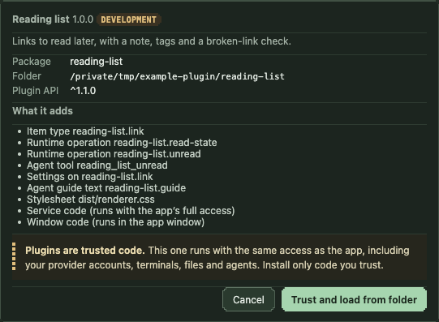

# Writing a plugin

This guide takes you from an empty folder to a released plugin that people install from git.
Follow the steps in order. Each step has code to copy and a **Done when** check; do not move on
until the check passes.

The worked example is [`examples/plugins/reading-list`](../../examples/plugins/reading-list): one
item type, a connector, a view, two runtime operations, an MCP tool, a settings section, guide
text, `plugin_records` storage, a stylesheet, tests and a build. Its end-to-end test is
[`tests/e2e/example-plugin.spec.ts`](../../tests/e2e/example-plugin.spec.ts). Visual rules are in
the [design guide](design.md).

**Placeholders.** Snippets use the namespace `acme` and the item type `acme.item`. Replace them
with yours everywhere, including MCP tool names (`acme_…`).

## Rules that apply to every step

1. **Plugins are trusted code.** Service code runs in the workspace service with the app's full
   access; window code runs in the app window. There is no sandbox. Never read credentials,
   tokens or files you do not need, and never send data anywhere the person did not ask for.
2. **Everything you register is in the manifest, under your namespace.** The host refuses
   undeclared item types, operations, tools, guide snippets, settings pages and account types.
3. **Three entries, three platforms.** `definitions` is platform-neutral (no `node:*`, no DOM),
   `service` is Node, `renderer` is the browser. Credentials and network clients stay in `service`.
4. **Import only the SDK** in production code: `@agent-crafting-table/plugin-sdk/index.ts`
   (types, `defineResourcePlugin`, manifest helpers), `…/views.ts` (window helpers) and
   `…/testing.ts` (tests only). Other host paths are not API and can change without notice.
5. **No new item-type branches in the app.** If your plugin seems to need one, use an extension
   point below or propose a new one; do not patch the map, graph or MCP transport.
6. **Tests never touch the network or a real account.** Inject fixtures.

## Step 0. Prerequisites

- macOS, git, and Node exactly as in the app's `package.json` `engines` (currently 26.8.2).
- A checkout of the app with dependencies and a build:

```sh
git clone <app repository> act && cd act
npm ci
npm run build
npm start                      # the app; quit it before running end-to-end tests
```

**Done when** `node packages/plugin-sdk/act-plugin.ts` prints
`Usage: act-plugin pack [dir] | act-plugin verify [dir]` and the app opens.

## Step 1. Create the package

Start from the example in its own repository. The package links the app's `node_modules`, which
contains the SDK (`@agent-crafting-table/plugin-sdk`), `esbuild`, `zod` and `typescript`.

```sh
APP="$PWD"                                         # the app checkout from step 0
cp -R "$APP/examples/plugins/reading-list" ~/act-plugin-acme
cd ~/act-plugin-acme
rm -rf dist act-plugin.integrity.json
ln -s "$APP/node_modules" node_modules
# Rename the namespace: package id, type ids, operations, collection names and MCP tools.
find . -path ./node_modules -prune -o -type f \( -name '*.ts' -o -name '*.json' -o -name '*.mjs' -o -name '*.md' -o -name '*.css' \) \
  -exec sed -i '' -e 's/reading-list/acme/g' -e 's/reading_list/acme/g' {} +
git init -b main
npm test
```

After the rename the item type is `acme.link`. Then, by hand:

- rename `link`, the display names (`Reading list`, `Reading link`) and the `reading-link` CSS
  classes as you go;
- delete what you will not use, together with its tests (for example `src/check.ts` and the
  "page checks" test when your plugin reads no web pages);
- rewrite `README.md` for your package. `package.json` `name` and `version` are for npm only;
  the app reads `act-plugin.json`.

```text
act-plugin-acme/
  act-plugin.json            manifest (step 2)
  package.json               scripts: build, test, typecheck, pack, verify, release
  tsconfig.json
  .gitignore                 node_modules (the link)
  scripts/build.mjs          bundles src/ into dist/ (step 15)
  scripts/act-plugin.mjs     runs the SDK's pack/verify through node_modules
  src/definition.ts          the item type (step 3)
  src/plugin.ts              definitions entry (step 4)
  src/connector.ts           read model (step 5), plus helpers such as src/check.ts
  src/service.ts             service entry (step 6)
  src/views.ts, renderer.ts  window entry (step 12)
  src/styles.css             tokens only (step 13)
  test/*.test.ts             contract harness and unit tests (step 14)
  dist/                      built output; committed only on release commits
```

**Done when** `npm test` and `npm run typecheck` pass in the new folder and
`grep -ri reading . --exclude-dir=node_modules` finds nothing you meant to rename.

## Step 2. Write the manifest

`act-plugin.json` declares everything the package registers. The parser rejects unknown keys.

```jsonc
{
  "id": "acme",                      // namespace: lowercase, dotted segments allowed (acme or acme.tools)
  "name": "Acme items",              // shown in Settings → Plugins and the install review
  "version": "1.0.0",                // semver; bump on every release tag
  "apiRange": "^1.1.0",              // caret range of the host plugin API (step 18)
  "description": "One sentence about what it adds.",   // ≤ 500 characters
  "entries": {                       // relative paths inside the release, normally dist/
    "definitions": "dist/definitions.mjs",   // required
    "service": "dist/service.mjs",           // optional, Node
    "renderer": "dist/renderer.mjs"          // optional, browser
  },
  "contributes": {                   // every list defaults to empty
    "itemTypes": ["acme.item"],                  // <namespace>.<name>
    "accountTypes": ["acme"],                    // connection providers (step 9)
    "runtimeOperations": ["acme.sync"],          // step 7
    "mcpTools": ["acme_report"],                 // namespace with _ for . and -, step 8
    "settingsPages": ["acme.item"],              // item types whose settings page shows your section
    "actionContributions": { "github.pull-request": ["acme.tag"] },   // actions on another package's type
    "agentGuide": ["acme.guide"],                // step 10
    "settingsPresets": ["acme.defaults"],        // values for another package's settings (API 1.1, 1.2)
    "css": ["dist/renderer.css"]                 // step 13
  },
  "legacyIds": []                    // ids outside the namespace that were saved before this package existed
}
```

Rules:

- Every id is `acme`, `acme.…`, or (MCP tools) `acme_…`, unless it is listed in `legacyIds`.
  Use `legacyIds` only to keep identities that already exist in people's workspaces.
- Two packages cannot declare the same id. A package cannot add actions to its own type.
- Entries and stylesheets must name files inside the release (`dist/…`).

**Done when** this prints your manifest's id:

```sh
node --input-type=module -e "import { parsePluginManifest } from '@agent-crafting-table/plugin-sdk/index.ts'; import { readFileSync } from 'node:fs'; console.log(parsePluginManifest(JSON.parse(readFileSync('act-plugin.json', 'utf8'))).id)"
```

## Step 3. Define the item type

`src/definition.ts` holds one `defineResourcePlugin` call per type. It is data plus pure
functions; the same object serves the map, the creation ring, validation and MCP discovery.

```ts
import { defineResourcePlugin } from '@agent-crafting-table/plugin-sdk/index.ts';

export const item = defineResourcePlugin({
  id: 'acme.item', apiVersion: 1, schemaVersion: 1,      // schemaVersion: bump only with a migration
  name: 'Acme item', icon: 'box',                         // icon: a name from the list below
  settingsHelp: 'What it is for, in one or two sentences.',
  preferredView: 'inspector', view: { width: 560, height: 420 },
  appearance: { tone: 'stone', shape: 'document', size: 'small' },
  mapSizes: { defaultSize: 'small', sizes: {
    small: { width: 200, height: 48, summaryLines: 0, description: 'Title and Needs me.' },
    medium: { width: 240, height: 84, summaryLines: 1, description: 'Adds the status line.' },
    large: { width: 260, height: 124, summaryLines: 1, fields: ['note'], fieldLines: 2, description: 'Adds the note.' },
  } },
  creation: { label: 'Add acme item', shortLabel: 'Acme' },
  webLink: { label: 'Open in Acme', template: 'https://acme.example/items/{key}' },
  context: { fields: ['key'] },
  fields: {
    key: { label: 'Key', kind: 'text', required: true, pattern: '^[A-Z]+-[0-9]+$', description: 'For example ACME-12.' },
    note: { label: 'Note', kind: 'text', multiline: true, rows: 3 },
  },
  validateData: data => String(data.key).length <= 20,   // only what fields cannot express
});
```

| Property | Rule |
|---|---|
| `id`, `apiVersion: 1`, `schemaVersion` | `id` is declared in `contributes.itemTypes`. Never change it after release. |
| `name` | Sentence case, singular: "Reading link", not "Reading Links". |
| `icon` | One of `box`, `bookmark`, `file`, `note`, `globe`, `link`, `server`, `terminal`, `workflow`, `rocket`, `inbox`, `clock`, `folder`/`project`, `grid`, `sparkles`, `square`, `square-check`, `circle`, `circle-dashed`, `settings`, `review`, `message-square`, `messages-square`, `git-pull-request`, `git-merge`, `archive`, `remote`. Unknown names draw `file`. Adding a glyph is an app change ([design guide](design.md#pixel-icons)). |
| `brand` / `providerBrands` | Only for provider logos the app already ships. |
| `appearance` | `tone`: `neutral` `mint` `teal` `violet` `blue` `rose` `stone` `copper` (type identity, never status). `shape`: reserved hint, use `rounded` or `document`. `size`: `icon` `tiny` `small` `medium` `large`; keep it equal to `mapSizes.defaultSize`. |
| `mapSizes` | Up to `small`/`medium`/`large`. `summaryLines` shows the snapshot `label`; `fields` shows declared, non-secret fields. Single-size types declare one size. |
| `view` | Expanded size in screen pixels. Omit `view.mode` for a normal expanded view; `inline` means no expanded view. |
| `creation` | Omit for items only your service creates. Field creation (`mode` omitted) asks for a title and the fields. `mode: 'url'` with `action: 'resource.attach'` and `matchInput` joins **From URL**; then the connector must return `title`. Do not match every URL: a generic matcher takes pasted links away from Web link. |
| `fields` | Kinds `text` (`multiline`, `rows`), `url`, `number` (`integer`, `min`, `max`), `boolean`, `select` (`options`, `optionLabels`), `directory`. `pattern` is also the HTML input pattern, so it must match the **whole** value (`'^https://\\S+$'`, not `'^https://'`). Never put secrets in fields. |
| `validateData` | Extra checks on the whole data object; fields are validated first. Pure and fast. |
| `webLink` | `https` template filled from data (`{field}`); a template that is only `{url}` takes a whole saved URL. Backs **Open in …** and, right after it, **Copy URL**, which you get without declaring anything. |
| `contextMenu` | Map-menu groups. `choices: { load, apply, runtime }` loads options from a runtime operation (step 7). Add `irreversible: true` for writes that cannot be undone ([design guide](design.md#irreversible-actions)). A child with `runs: ['<child id>', …]` starts those children of the same group together, each with its own toast. People can reorder a type's menu entries in Settings → Items → Right-click menus; a saved order names your group as `plugin:<group id>`, so **keep group ids stable**. A renamed id is a new entry in its default place and the old id is ignored. |
| `context` | Safe saved fields agents may see in the project brief. |
| `providerIdentity(data)` | Stable key for provider items so the same item is not added twice. Service-only. |
| `connectionProvider` | The account type this item reads with (step 9). Store a `connectionId`, never a token. |
| `relationships` | `{ cardinality: 'one' }` limits links to one partner. |
| `manualAcknowledge` | Accepted for compatibility; no effect. Opening never clears Needs me for any type, only **Seen** / **Mark seen** do. |
| `migrations` | Data upgrades (step 11). |

**Done when** the contract harness passes for the type (step 14 shows the test; the example's
`npm test` already runs it).

## Step 4. Write the definitions entry

`src/plugin.ts` exports the definitions module. It loads in the service, the MCP bridge and the
window, so keep it platform-neutral.

```ts
import * as z from 'zod/v4';
import type { PluginDefinitionsModule } from '@agent-crafting-table/plugin-sdk/index.ts';
import { item } from './definition.ts';

const plugin: PluginDefinitionsModule = {
  definitions: [item],
  runtimeOperations: [
    { id: 'acme.sync', description: 'Refreshes an acme item from Acme.', agentPolicy: 'allow' },
    { id: 'acme.state', description: 'Shows or sets the item state.', agentPolicy: { operations: { options: 'allow' }, otherwise: 'humanOnly' } },
  ],
  mcpTools: [{
    name: 'acme_report',
    description: 'List acme items that need attention: node ID, title and reason. Read-only.',
    inputSchema: z.object({ limit: z.number().int().min(1).max(50).optional() }).strict(),
    annotations: { readOnlyHint: true, idempotentHint: true, openWorldHint: false },
    request: (input, binding) => ({ action: 'acme.report', nodeId: String(binding.projectId ?? 'acme'), arguments: input }),
  }],
  agentGuide: [{ id: 'acme.guide', text: 'Acme items (acme.item) … one short paragraph.' }],
  settings: { typeId: 'acme.item', label: 'Acme', fields: {
    enabled: { label: 'Sync with Acme', kind: 'boolean', default: true, description: 'What happens when it is on, and when it is off.' },
  } },
};
export default plugin;
```

Every id here must also be in the manifest, and the reverse. `acme.report` in the tool above
would need its own declaration; the example's tool forwards to `reading-list.unread`.

**Done when** `npm test` passes: `pluginPackageContract` fails on any mismatch between the
manifest and this module.

## Step 5. Read data with a connector

A connector turns a saved item into a **snapshot** for the card and the view. It runs in the
service. Copy the shape from [`connector.ts`](../../examples/plugins/reading-list/src/connector.ts).

```ts
import type { ResourcePluginConnector } from '@agent-crafting-table/plugin-sdk/index.ts';

export function acmeConnector(client: AcmeClient): ResourcePluginConnector {
  return {
    pollIntervalMs: 15 * 60_000,                  // opt into background reads; the host enforces ≥ 60 s
    async load(resource, signal, { background = false } = {}) {
      const remote = await client.get(String(resource.data.key), signal);   // pass signal on
      return {
        activity: remote.running ? 'working' : 'idle',   // working | idle | complete | unknown
        attention: 'none',                               // legacy field; use attentionReason
        connection: 'connected',
        label: remote.running ? 'Running · 3 of 5' : 'Idle',   // card summary line, ≤ ~40 characters
        observedAt: new Date().toISOString(),
        attentionReason: remote.failed ? 'error' : null,       // null clears Needs me
        ...(remote.failed ? { attentionNote: 'Sync failed' } : {}),
        detail: { status: remote.status, updatedAt: remote.updatedAt },   // JSON for your view
      };
    },
    async getContext(resource) {
      return { resourceId: resource.id, title: resource.title, content: '…bounded text for agents…' };
    },
  };
}
```

Snapshot fields:

| Field | Meaning |
|---|---|
| `label` | Short status line on medium and large cards and in lists. |
| `title` | Only an authoritative provider title. It **replaces the item title** on the map. Omit it for items people name themselves. |
| `detail` | JSON for your view; never HTML. Keep it bounded. |
| `activity` | `working` draws the working rim; `complete` slows polling. |
| `attentionReason`, `attentionNote` | Needs me (step 16). `undefined` leaves it unchanged; `null` clears it. |
| `attentionEventId` | Set only when each new event should alert again (a new failed run). |
| `indicators` | Up to four small cues: `icon` from `check`, `message-square`, `git-pull-request`, `git-merge`, `x`, `clock`, `alert-triangle`; `tone` from `neutral`, `green`, `blue`, `amber`, `violet`, `red`. |
| `pollWithinMs` | "Look again within this long" while something is about to change. |
| `done` | The provider considers the item finished; mirrors onto Mark done. |

Failures: **throw** an `Error` with a short, human message ("Acme is not reachable."). The host
keeps the last snapshot, marks it stale (the view shows **Saved copy**), and retries after 15 s.
For rate limits, attach `retryAt` (epoch ms) to the error to back off the whole account.

Poll budget etiquette:

- Opt into `pollIntervalMs` only when the remote state changes without the person acting. Pick
  the longest interval people tolerate; the host stretches it further while nothing changes,
  skips archived and done items, and reads one item at a time.
- `background: true` marks the host's own polls. Do less there: skip items nobody is waiting on.
- Reads within 60 s return the host's cached snapshot unless the person presses ↻ (`refresh`).
- Reuse your own recent results when one action triggers several reads (the example keeps the
  last check for a minute in `plugin_records`).
- Always pass `signal` to `fetch` and stop work when it aborts. Bound time, size and redirects.
- Fetch only `https`, send no cookies or credentials you were not given for that host, and refuse
  private and loopback addresses (see [`check.ts`](../../examples/plugins/reading-list/src/check.ts)).
  Its DNS check is a guard against accidents, not against DNS rebinding.

Connector actions (`actions()` + `execute()`) are item-specific commands that both people and
agents call through `resource.action`. Mark writes `readOnly: false` and give them
`humanOnly: true` when only a person may confirm them; MCP refuses those.

**Done when** `resourceConnectorContract` passes with a fixture client (step 14).

## Step 6. Write the service entry

```ts
import type { ServiceModule, WorkspaceServices } from '@agent-crafting-table/plugin-sdk/index.ts';
import { acmeConnector } from './connector.ts';

const service: ServiceModule = {
  activate(host) {
    let workspace: WorkspaceServices | undefined;
    const ready = () => { if (!workspace) throw new Error('The workspace is still starting. Try again.'); return workspace; };
    host.connector('acme.item', acmeConnector(new AcmeClient()));
    host.runtimeOperation('acme.state', context => setState(context, ready()));
    host.onWorkspace(services => {
      workspace = services;
      return { pause: () => stopTimers(), close: () => stopTimers() };   // optional lifecycle hooks
    });
  },
};
export default service;
```

Rules:

- **Prefer registering inside `activate`.** Registrations made during `activate` are held
  back and applied only if it succeeds, so a failing package leaves nothing half-registered.
  Later registrations (for example inside `onWorkspace`) apply immediately, but an agent or a
  person can call an operation before it exists, so keep the workspace in a variable instead, as above.
- `activate` must finish within 5 s. A package that throws or hangs registers nothing and is
  turned off with the reason shown in Settings → Plugins.
- `onWorkspace(services => lifecycle)` hands you `storage`, `control` (read the map), `resources`
  (`read(nodeId, refresh)`), `allowed()` and `execute(work)`. Lifecycle hooks: `observe` after
  every committed change, `start`, `pause`, `close`. Stop timers in `pause` and `close`.
- `host.settings()` returns your settings with defaults filled in; read it at call time.
- `host.connections` resolves saved accounts (step 9). It is absent in fixture hosts.
- `host.presentation(typeId, { indicators, attention, opened })` adds cues computed from the saved
  snapshot without a provider read. `opened` runs when the person opens the item's web link
  from the app (runtime operation `resource.opened`, human-only), e.g. to mark comments read.
- Ten failures in a row from anything you registered pause it for five minutes.

**Done when** the end-to-end check in step 15 shows your item reading data.

## Step 7. Add runtime operations

A runtime operation is a named command on a node. People reach it from your view
(`services.runAction(id, args)`) or a context-menu choice; agents reach it through
`workspace_run` or your MCP tool.

```ts
host.runtimeOperation('acme.state', async context => {
  const { operation, value } = context.arguments;                 // validate everything
  if (operation === 'options') return { current: 'open', context: {}, options: [{ id: 'open', label: 'Open' }, { id: 'closed', label: 'Closed' }] };
  if (operation !== 'set' || (value !== 'open' && value !== 'closed')) throw new Error('Choose Open or Closed.');
  await context.execute(async () => { /* the write */ });          // lifecycle gate for writes
  return { ok: true };
});
host.runtimeOperation('acme.report', context => report(context.arguments), { requiresNode: false });
```

Agent policy, declared next to the operation in `plugin.ts`:

| Policy | Agents |
|---|---|
| `'allow'` (default) | may run it |
| `'humanOnly'` | are refused with "This action needs a person to confirm it in the app." |
| `{ redirect: 'Use acme_report.' }` | are refused with your message pointing to a tool |
| `{ operations: { options: 'allow' }, otherwise: 'humanOnly' }` | per `arguments.operation` |

Use `humanOnly` for anything that speaks for the person (marking read, approving, merging,
posting) or cannot be undone. The person in the app is never limited by the policy.

`requiresNode: false` lets an operation run without a node (`context.node` and
`context.resource` are then undefined). Otherwise check `context.resource?.pluginId`.

**Done when** a unit test proves the policy:

```ts
import { agentRuntimeRefusal } from '@agent-crafting-table/core/runtime.ts';
assert.match(agentRuntimeRefusal({ action: 'acme.state', arguments: { operation: 'set' } }, plugin.runtimeOperations) ?? '', /needs a person/);
assert.equal(agentRuntimeRefusal({ action: 'acme.state', arguments: { operation: 'options' } }, plugin.runtimeOperations), undefined);
```

## Step 8. Add an MCP tool

A tool gives agents a typed entry point; it forwards one validated request to a runtime operation.

- Name: `acme_<verb>` (lowercase, `_`), ≤ 64 characters.
- Description: what it returns or does, the inputs, and limits ("Read-only.", "Only the agent
  the request was sent to can report it."). Agents read it literally.
- `inputSchema`: a strict `z.object`. Bound every string and number.
- `annotations`: set `readOnlyHint`, `destructiveHint`, `idempotentHint`, `openWorldHint` honestly.
- `requiresAgent: 'message'` refuses callers that are not agents launched from the table.
- `request(input, binding)` returns `{ action, nodeId, arguments }`. `binding` has `agentNodeId`,
  `projectId`, `workspaceId` when known.
- Tools skip `workspace_run`'s policy check, so forward only to operations (or operation modes)
  agents may run.

**Done when** a unit test checks `tool.request(...)` and that `tool.inputSchema` rejects bad input.

## Step 9. Settings, presets and account types

**Settings section.** One section per package, shown on the item type's settings page
(**Settings → Items → [type]**) and stored under `settings.plugins.<package id>`. Declare the type
in `contributes.settingsPages`. Every field needs a `default`; booleans render as switches.
Settings sections also take `kind: 'multiselect'` (checkboxes for `options`, stored as a list, with
a list `default` and an optional `emptyHint` shown while nothing is checked) and, on any field,
`enabledBy: '<boolean field>'` to make it unavailable while that switch is off.
Describe both states in `description`.

**Settings presets (API 1.1; every workspace since 1.2).** `settingsPresets: [{ id: 'acme.defaults',
packageId: 'other', values: { … } }]` supplies values for another package's declared settings. Each
preset applies once per workspace when your package loads (the reload after install, turn on or
update), to settings that are unset or still at their defaults; a value the person changed is kept,
and a preset id never applies twice, so change the id to ship new values. A preset for a package that
is not loaded yet waits until it is. Removing your package leaves the applied values in place.

**Account types.** For items that read with a person's account, register a connection provider
and declare it in `contributes.accountTypes`:

```ts
host.connectionProvider({
  id: 'acme', name: 'Acme', order: 60,
  setupHint: 'Uses your Acme CLI login. Run acme login first.',
  setupSteps: [{ text: 'Sign in with the Acme CLI.', command: 'acme login' }, { text: 'Click Connect Acme and choose the account.' }],
  accounts: async signal => [{ id: 'me', label: 'me@acme', available: true, active: true, credentialSource: 'Acme CLI' }],
});
const connections = host.connections;
if (connections) host.connector('acme.item', acmeConnector(resource => {
  const account = connections.resolve('acme', resource.connectionId).account;   // throws "Connect Acme in Settings…"
  return new AcmeClient(account);
}));
```

Set `connectionProvider: 'acme'` on the definition. Resolve the token inside the service at call
time from the provider's own store (CLI, keychain); never save it in item data, settings or
`plugin_records`.

**Done when** the section appears under Settings → Items → your type and saving it changes what
`host.settings()` returns (the example's end-to-end test does exactly this).

## Step 10. Add agent guide text

`agentGuide: [{ id: 'acme.guide', text }]` is appended to the guide every agent launched from the
table receives. One short paragraph: what the type holds, when to create one (`item.add` with
`pluginId: 'acme.item'`), which tool to use, and what agents must never do. No secrets, no
marketing, no instructions that widen what agents are allowed to do.

**Done when** the contract test passes (it checks the snippet is declared).

## Step 11. Store plugin state

`WorkspaceServices.storage` is your package's `plugin_records`: rows in the workspace database,
backed up and migrated with it.

```ts
storage.put('links', resource.id, { readAt: new Date().toISOString() });   // JSON value
storage.get('links', resource.id)?.value;
storage.list('links', { limit: 100, after: { key: lastKey } });            // ordered by ordinal, then key
storage.delete('links', resource.id);
storage.transaction(() => { /* several writes */ });
```

- Collections are lowercase, ≤ 64 characters; keys 1–512 characters; a row ≤ 1 MiB; a package
  ≤ 16 MiB. `undefined` properties are dropped.
- Store what is yours: read marks, check results, small caches. Item content belongs in item data;
  secrets belong nowhere.
- Rows are not deleted with items. Key them by resource id and prune in `observe` if they grow.

**Item data migrations.** Bump `schemaVersion` only when the saved data shape changes and add a
synchronous migration for each step:

```ts
schemaVersion: 2,
migrations: [{ fromVersion: 1, toVersion: 2, migrate: data => ({ ...data, tags: String(data.tags ?? '').split(',').filter(Boolean).join(', ') }) }],
```

A migration gets a copy of the data and returns new data; it cannot change ids, titles, links or
layout. The app upgrades all items of the type atomically with a backup; a failure leaves every
record untouched and the type unavailable with the reason. Build each version's `validateData`
from its own fields.

**Done when** a unit test round-trips a v1 record through your migration and `validateData`.

## Step 12. Build the view

`src/renderer.ts` registers views; `src/views.ts` builds plain DOM. No framework is required, no
network calls (ask the service through `services.runAction`), no `innerHTML` with data.

```ts
import type { RendererModule } from '@agent-crafting-table/plugin-sdk/index.ts';
const renderer: RendererModule = { activate(host) { host.views('acme.item', acmeViews); } };
export default renderer;
```

The **frame header contract** (see the [design guide](design.md#item-view-header)): the host draws
the icon, the title and the close button. Your view supplies data for the rest of the frame bar
with `mountViewHeader`: status chip · meta line · primary actions · ↗ · freshness · ↻.

```ts
import { mountViewHeader, skeleton, staleNotice, emptyState, formatWhen } from '@agent-crafting-table/plugin-sdk/views.ts';

export const acmeViews: ResourcePluginViews = {
  mountDetail(container, resource, services) {
    const document = container.ownerDocument, root = document.createElement('section'), body = document.createElement('div');
    root.className = 'acme-view'; root.append(body); container.append(root);
    const bar = mountViewHeader(document, services, root, { onRefresh: () => { if (active) void load(true); } });
    const primary = document.createElement('button');
    primary.type = 'button'; primary.className = 'btn'; primary.dataset.variant = 'primary'; primary.dataset.size = 'sm';
    bar.actions.append(primary);
    bar.update({ link: { url: 'https://acme.example/…', provider: 'Acme' } });
    body.append(skeleton(document));                                   // loading
    let active = false, disposed = false, generation = 0;
    async function load(refresh = false) {
      const ticket = ++generation; bar.busy(true);
      try {
        const snapshot = await services.runAction('resource.read', { refresh }) as unknown as ResourceSnapshot;
        if (!active || disposed || ticket !== generation) return;      // drop late answers
        bar.update({ status: { label: 'Open', tone: 'green' }, meta: ['ACME-12', `Updated ${formatWhen(String(snapshot.detail?.updatedAt))}`], link: { url: '…', provider: 'Acme' } });
        bar.freshness({ observedAt: snapshot.observedAt, stale: snapshot.stale, error: snapshot.error, provider: 'Acme' });
        body.replaceChildren(/* content, or emptyState(document, 'Nothing here yet') */);
      } catch (error) {
        if (active && !disposed && ticket === generation) body.replaceChildren(emptyState(document, 'Couldn’t load this item', { detail: (error as Error).message }));
      } finally { if (!disposed && ticket === generation) bar.busy(false); }
    }
    return {
      update() {},
      setActive(value) { if (active === value) return; active = value; generation++; if (active) void load(); else bar.busy(false); },
      dispose() { disposed = true; generation++; bar.dispose(); root.remove(); },
    };
  },
};
```

The full version with the saved-copy first paint, the stale banner and a primary action is
[`views.ts`](../../examples/plugins/reading-list/src/views.ts). For provider documents with no
primary action, `mountProviderRead(container, services, { className, provider, header, render })`
does all of this for you.

View services you may use: `runAction` (runtime operations and `resource.read` with `refresh` or
`cachedOnly`), `openUrl`, `copyUrl`, `editResource` (the host's edit form), `openResource`,
`observeRelated`, `frameToolbar`. Rules:

- Load when `setActive(true)` arrives, not in `mountDetail`; stop when it turns false.
- `dispose` removes every listener, timer and element you added. Disposing a view never stops
  work in the service.
- Text goes in with `textContent`. For Markdown use `renderMarkdown` from the SDK views.
- Do not draw your own title row, close button or freshness text; the frame owns them.

Other window extension points: `mountNode` (custom map card content; prefer the generic card),
`preview` (hover facts from saved state only), and `host.contributeViews(type, { headerAction })`
to add a control to another package's view header.

**Done when** the item opens, the chip and meta line sit in the frame bar, ↻ reloads, and closing
and reopening leaves no duplicate elements (check with the element inspector).

## Step 13. Style with tokens only

List the stylesheet in `contributes.css`. Scope every selector under your view's root class.

```css
.acme-view { padding: var(--act-sp-6); color: var(--act-ink); font: var(--act-fs-body)/1.5 var(--act-font-ui); }
.acme-view-meta { color: var(--act-ink-dim); font-size: var(--act-fs-ui); }
.acme-view-row:focus-visible { outline: var(--act-focus-ring); outline-offset: 2px; }
@container (max-width: 560px) { .acme-view { padding: var(--act-sp-4); } }
```

- Colours, sizes, spacing, fonts, shadows and z-index come from `--act-*` tokens
  ([design tokens](../design-tokens.md)). No hex, `rgb()` or `hsl()` values; no border radius.
- Short local aliases are fine if they point at tokens (`--acme-ink: var(--act-ink)`).
- Reuse the app's classes where they exist: `.btn[data-variant][data-size]`, `.view-chip`,
  `.view-empty`, `.view-stale-banner`.

**Done when** your test (copy the example's "design tokens only" test) passes.

## Step 14. Test

```ts
import { pluginPackageContract, resourceConnectorContract } from '@agent-crafting-table/plugin-sdk/testing.ts';
import manifest from '../act-plugin.json' with { type: 'json' };
import plugin from '../src/plugin.ts';
import { item } from '../src/definition.ts';

pluginPackageContract({ manifest, module: plugin }, {
  fixtures: { 'acme.item': { valid: { key: 'ACME-1' }, invalid: [{ key: 'lowercase-1' }, {}] } },
});
resourceConnectorContract(item, { valid: { key: 'ACME-1' }, connector: () => acmeConnector(fixtureClient()), actions: { /* one input per advertised action */ } });
```

- `pluginPackageContract` checks manifest ↔ registrations, serializable descriptions, MCP tool
  shapes and, per type with fixtures, create/update/alias/archive/restore and the
  missing-plugin placeholder.
- `resourceConnectorContract` checks snapshots, action schemas, context and cancellation. It
  needs an input for every advertised action.
- Add unit tests for your own logic: Needs me reasons, polling decisions, operations, policies,
  MCP requests, migrations. Use an in-memory `PluginStorage` (see
  [`plugin.test.ts`](../../examples/plugins/reading-list/test/plugin.test.ts)).
- If your package depends on another package's types (presets, actions on its type), pass
  `dependencies: bundledPackages` from `@agent-crafting-table/plugins/bundled/packages.generated.ts`.

End-to-end: copy [`tests/e2e/example-plugin.spec.ts`](../../tests/e2e/example-plugin.spec.ts). It
launches the built app with `ACT_TEST_DATA_DIR` set to a temporary folder, stubs the folder
dialog, loads the build with **Load from folder**, and drives the item. Run it from the app
checkout with the app built and not running.

**Done when** `npm test` and `npm run typecheck` pass.

## Step 15. Run it in the app (dev loop)

```sh
npm run build                      # writes dist/
```

1. Start the app (`npm start` in the app checkout, or your installed app).
2. **Settings → Plugins → Advanced settings → Load from folder…**, choose your package folder.
3. Read the review (it lists everything the manifest adds) and click **Trust and load from folder**.
   The service restarts and the window reloads. The row says **Running · Development**.

   

4. Double-click the map → **All** → your type, fill the fields, add it. Open it.
5. After a code change: `npm run build`, then **Settings → Plugins → Advanced settings → Reload
   plugins**. Node caches modules, so a restart is the only reliable reload.

If the row says **Failed**, the reason is next to it. Service errors also appear in the item's
frame.

**Done when** your item reads data, its view works, and its operation runs from the app.

## Step 16. Raise Needs me correctly

Needs me is the one place people look for "what is waiting on me".

- Raise it from the snapshot: `attentionReason` plus `attentionNote`. Reasons:
  `error` (action required), `input` (waiting for the person), `review` (ready for review),
  `finished` (done, ready to view). Other reasons belong to built-in types.
- `attentionNote` is the **reason people read**: 2–5 words, sentence case, no trailing period,
  names the trigger. "Link is broken", "Sync failed", "Build needs approval". The host trims it to
  one line of 48 characters.
- Return `attentionReason: null` when the cause is gone; Needs me clears.
- Opening the item marks it seen. A new cycle (reason changes from `null` to a reason, or a new
  `attentionEventId`) alerts again; an unchanged poll does not.
- Do not raise Needs me for things nobody can act on (the network is down, a background poll
  failed); throw or show it in the view instead.

**Done when** a unit test asserts the reason and note and that it clears (the example has one).

## Step 17. Build and pack a release

`scripts/build.mjs` bundles each entry with esbuild into one self-contained ESM file. SDK helpers
are bundled in; the host is reached only through `ServiceHost`/`RendererHost`. The definitions
build fails on `node:*` imports.

```sh
npm run release                    # build, then pack (writes act-plugin.integrity.json), then verify
```

`pack` refuses a manifest that does not parse, needs another plugin API, or names files outside
the release. A release is only `act-plugin.json`, `act-plugin.integrity.json` and `dist/`: regular
files (no symbolic links), ≤ 2000 files, ≤ 64 MiB.

**Done when** `npm run verify` prints `every released file matches act-plugin.integrity.json`.

## Step 18. Release on a git tag

```sh
npm run release
git add act-plugin.json act-plugin.integrity.json dist package.json src scripts test README.md
git commit -m "release 1.0.0"
git tag v1.0.0
git push origin main v1.0.0        # only when you mean to publish
```

- Bump `version` in `act-plugin.json` for every tag. The install review shows it.
- Commit `dist/` only together with a fresh integrity file; a tampered or stale file fails install.
- Tags are what people install; do not move a published tag.

**Done when** `git show v1.0.0:act-plugin.integrity.json` lists your dist files.

## Step 19. Install from git

In the app: **Settings → Plugins**, **Repository URL** (`https://…`, `ssh://…`, `git@host:path` or a
local path; credentials in the URL are refused), **Tag, branch or commit** (`v1.0.0`), **Fetch**.
The app fetches with your own `git` (no prompts, no hooks), verifies every file against the
integrity file and shows the review. **Trust and install** pins that commit.

To test this without a server:

```sh
git clone --bare ~/act-plugin-acme ~/act-plugin-acme.git     # then use /Users/<you>/act-plugin-acme.git
```

Remove a **Development** copy of the same package first: one package id loads once. Updates are
a new fetch of a tag and a new approval; **Roll back** returns to one of the three previous builds.

**Done when** the row says **Running** with your version and commit, and your items work.

## Step 20. Stay compatible

- `apiRange` is a caret range of the host plugin API (`PLUGIN_API`, currently `1.2.0`):
  `^1.0.0` loads on any 1.x host; `^1.1.0` needs 1.1 or later (settings presets); `^1.2.0` needs a host
  that applies presets to every workspace, not only to ones with older settings. Use the lowest
  minor whose features you use.
- On a host whose major API differs, the package does not load and its items stay on the map as
  placeholders with their data. They come back when a compatible build is installed.
- Never rename item type ids, field keys, operation ids or tool names after a release. If you
  must move an id into another package, list it in that package's `legacyIds`.
- Change data shape only with `schemaVersion` and a migration (step 11).

## Common pitfalls

| Symptom | Cause | Fix |
|---|---|---|
| "This runtime action is not connected" | Operation called before it was registered (registered late, e.g. in `onWorkspace`) | Register in `activate`; keep the workspace in a variable |
| Creation form won't submit, "must match the requested format" | `pattern` not matching the whole value | Anchor and cover the full string: `'^https://\\S+$'` |
| Item title changes to something else after a read | Snapshot returned `title` | Omit `title` unless the provider owns the name |
| View shows old data after a settings change | Reads within 60 s reuse the cached snapshot | Press ↻ (`refresh: true`), or re-read from your operation with `resources.read(nodeId, true)` |
| "contributes identifiers outside its namespace" | An id without your prefix | Prefix it, or list a pre-existing id in `legacyIds` |
| "names files outside the release" | Manifest points at `src/` | Point entries and CSS at `dist/` and build first |
| "definitions must stay platform-neutral" | `node:*` import reachable from `plugin.ts` | Move it to the service entry |
| A link you put in the frame bar does nothing | The window blocks navigation; only `<a href>` inside the view body is routed to the browser | For controls in the frame bar call `services.openUrl(url)` |
| Two Needs me alerts for one cause | New `attentionEventId` on every poll | Set it only for genuinely new events |
| Package fails with a timeout on start | Network or disk work in `activate` | Do it lazily in the connector or after `onWorkspace` |
| Hex colours rejected | Literal colours in CSS | Use `--act-*` tokens |

## Release checklist

- [ ] Manifest: id, name, version bumped, `apiRange`, every contribution declared.
- [ ] Every id is in your namespace or in `legacyIds` for a reason.
- [ ] No credentials in item data, settings, `plugin_records`, logs or guide text.
- [ ] Connector: `signal` passed on, failures throw short messages, polling justified.
- [ ] Needs me: 2–5 word reason, clears with `null`.
- [ ] Writes that speak for the person are `humanOnly`; irreversible menu choices are `irreversible`.
- [ ] View: frame header contract, loading/empty/error/stale states, `dispose` cleans up.
- [ ] CSS: tokens only, scoped selectors, visible focus.
- [ ] `npm test`, `npm run typecheck`, `npm run release` pass; the dev loop works in the app.
- [ ] `dist/` and `act-plugin.integrity.json` committed on the tagged commit.
