# Plugin design guide

How a plugin's cards, views, states and words should look and read so that people cannot tell a
plugin from a built-in item. Read it with the [authoring guide](authoring.md); the
[design tokens](../design-tokens.md) list every colour, size and spacing value.

Screenshots come from the real app with neutral sample data. The `reading-link-*`, `zoom-near/mid/icons`,
`needs-me-reason` and `plugin-*` images are written by
`ACT_DOC_SCREENSHOTS=1 npx playwright test tests/e2e/example-plugin.spec.ts`; the others are crops
of the visual baselines in `tests/visual/baselines/darwin`.

## The split: what you choose, what the app owns

| You choose | The app owns |
|---|---|
| Type icon, tone, name | Card shape, edges, shadow, resize grip, ports |
| Map sizes and which public fields they show | Zoom behaviour, icons at far zoom, dashboards |
| The snapshot `label` (summary line) and indicators | The Needs me badge, working rim, selection outline, done check |
| The Needs me reason text | Needs me colour, counts, list, notifications |
| View body and the data in the frame bar | Frame, title, close, ↗, freshness stamp, ↻ |
| Settings fields | Settings layout, switches, inputs, Save |

If a design needs something from the right column, ask for a new extension point instead of
drawing it yourself.

## Map card anatomy

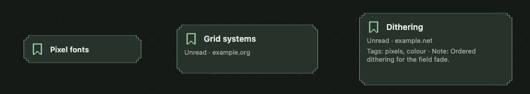

From left to right: Small, Medium and Large cards of the example type.

1. **Type icon** (12×12 pixel glyph, tinted by the type tone). It is the only thing left at far
   zoom, so pick a distinct one.
2. **Title**, at most two lines. People name items; do not overwrite their title from a read
   unless the provider owns the name.
3. **Summary line**: the snapshot `label` ("Unread · example.org"). Medium and larger.
4. **Fields**: declared, non-secret fields ("Tags: pixels, colour · Note: …"). Large only.
5. **Top-right slot**: the amber Needs me badge, or the done check. Host-drawn.
6. **Indicators**: up to four small cues from the fixed icon set. Host-drawn from your snapshot.

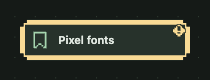

## Sizes S/M/L

Sizes are relative to the type, not global. Declare only the ones that add something.

| Size | Shows | Typical |
|---|---|---|
| Small | icon, title, Needs me | 150–240 × 44–64 |
| Medium | + summary line | 200–260 × 82–104 |
| Large | + declared fields, two lines | 240–300 × 112–132 |

Rules:

- `appearance.size` equals `mapSizes.defaultSize`, and the default preset keeps the type's native
  dimensions.
- A larger size never fetches anything or shows data the item has not saved.
- Descriptions in `mapSizes` say what the size adds ("Adds the note."), because Settings shows them.
- Types that are only useful at one size declare one size; the Size controls then disappear.

## Zoom levels

| Level | Zoom | What a card shows | Image |
|---|---|---|---|
| Near | 75% and above | The full card at its size |  |
| Mid | about 75% to 55% | Cards shrink; titles wrap; small text drops first | 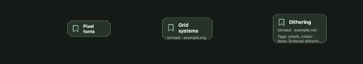 |
| Icon | below about 55% | Title-less 46 px icons with one status badge | 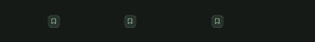 |
| Dashboard | below the dashboard threshold (65% by default) | Projects show a dashboard instead of their items; floating items stay icons | 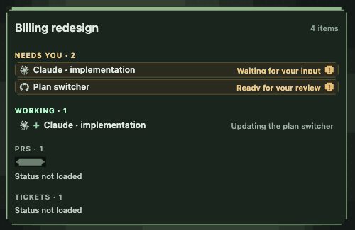 |

What this means for a plugin:

- The icon must identify the type alone. Test it at 45%.
- Lead the `label` with the state word ("Broken", "Unread · …", "Running · 3 of 5"), so a cut
  line still says the important part.
- Dashboards list items under **Needs you** and **Working** using your Needs me reason and
  `label`. Types that are pipelines or tallies (PRs, tickets) declare
  `overview: { pipeline }` or `overview: { tally }` to get their own dashboard section.

## Status cues and how they shrink

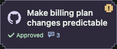

- **One cue, one fact.** "Approved" and "3 comments" are two indicators, not one sentence.
- **Count-only rule.** When a cue does not fit, it shrinks to its glyph and a number ("3" with
  the comment glyph). It is never cut mid-word: "Approv…" is worse than an icon. Write labels
  that survive this: the glyph carries the meaning, the label adds detail.
- At most four indicators, in priority order (most important first). Pick `icon` from `check`,
  `message-square`, `git-pull-request`, `git-merge`, `x`, `clock`, `alert-triangle`.
- Indicator tones: `green` good outcome, `red` failure, `amber` only for something waiting on the
  person, `blue` running or informational, `violet` merged/finished in provider terms,
  `neutral` everything else.
- Partly visible neighbouring projects show only an amber count ("!2"); your type contributes to
  it through Needs me, nothing else.

## Colour roles you must not repurpose

These colours mean one thing everywhere. A plugin that uses them for something else teaches people
to ignore them.

| Role | Looks like | Means | Plugin rule |
|---|---|---|---|
| Needs me | Amber `!` badge, amber text (`--act-attention`, `--act-pending`) | The person must act | Raise it through `attentionReason`; never paint amber for decoration or "warning-ish" states |
| Working | Mint dashed rim around the card | A process is running now | Set `activity: 'working'`; never draw rims or dashed borders |
| Selection | Solid 2 px white-mint outline (`--act-selection`) | Selected on the map | Never outline cards or rows yourself |
| Done | Struck-through title and a pixel check in the corner | The person marked it done | Mirror provider completion with `done`; do not draw checks in the corner slot |
| Failure | Red (`--act-bad`, `--act-error`) | Something failed | Use for real failures only, with words |
| Agent identity | Claude and Codex colours | Which agent | Never as status |
| Type tone | Card tint (`stone`, `blue`, …) | Which type | Identity only; never change it with state |

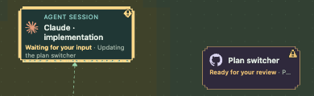
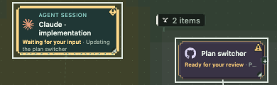
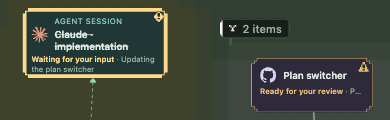

## Item view header

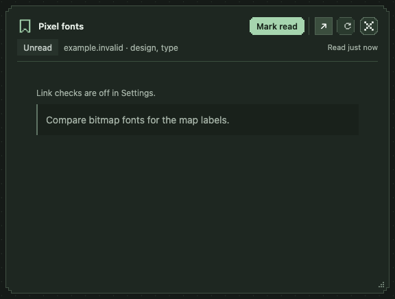

The expanded view's header is the frame bar, two rows at every width:

1. **icon · title** (host) · **blocked by** (host) ··· **actions** · **⋯** · **↗** · **↻** · **close** (host)
2. **status chip** · **meta line** ··· **freshness**

Row 1 never wraps. All its controls are `--act-control-size` (26 px) tall. When it runs out of
room, the blocked-by chips ellipsize first, then secondary actions move, rightmost first, into
a **⋯ More actions** menu; an action marked `data-primary` stays. Only then does the title
truncate. Below 880 px the blocked-by chips become one "Blocked · N" chip.

| Part | Rule |
|---|---|
| Title | Appears once, in the frame bar. Do not repeat it in the body. Long documents may repeat it only when the view is wider than 900 px. |
| Status chip | One job: the item's current state in one or two words ("Unread", "Broken", "In progress"). Tone from `neutral`, `green`, `blue`, `amber`, `violet`, `red`, mapped as for indicators. A chip may open a state menu (`choices`) and then shows ▾. |
| Meta line | Reference, scope, counts and times joined with " · " ("example.org · design, type · Read 2 min ago"). No labels like "Status:"; nothing that is already in the chip. |
| Actions | Append buttons to `bar.actions`. At most one filled (`primary`) button, chosen by state ("Mark read" / "Mark unread"); mark it `data-primary` so it never moves into ⋯. Others are `secondary`. Irreversible ones use the `copper` trigger and a confirm (below). A collapsed action keeps its click handler; a menu it opens anchors under ⋯. |
| ↗ | "Open in {Provider}" for the item's page. Set `link` in the header data. |
| Freshness | "Read 2 min ago" (full time in the tooltip); amber "Saved copy · 14:02" when the last refresh failed. Supplied by `bar.freshness(...)`. |
| ↻ | Refresh from the provider. Disabled while reading. |

Times use `formatWhen`: `relative` ("just now", "18 min ago", "3 h ago", then a date), `stamp`
("14:02" today), `short` ("Sep 25, 14:13"), `day` ("Sep 25"), `full` for tooltips. Never seconds.

The body uses a 24 px inset (16 px below 560 px) and a centred reading column above 1000 px.

## Empty, loading, error and stale states

| State | Show | Copy |
|---|---|---|
| Loading, nothing saved | Header from local data, "Reading…" in the freshness slot, `skeleton()` body | none |
| Loading, saved copy exists | The saved copy immediately (`resource.read` with `cachedOnly`), then the fresh read | none |
| Empty | One `emptyState()` block: what is missing, then how to fill it | "No note yet" / "Edit the item to add why you saved it." |
| Error, nothing saved | A status banner with the message; empty body | The connector's message, e.g. "Acme is not reachable." |
| Stale | Amber "Saved copy · 14:02" and one `staleNotice()` banner under the header | "Couldn’t refresh from Acme. Acme is not reachable. You’re reading the copy saved at 14:02." |

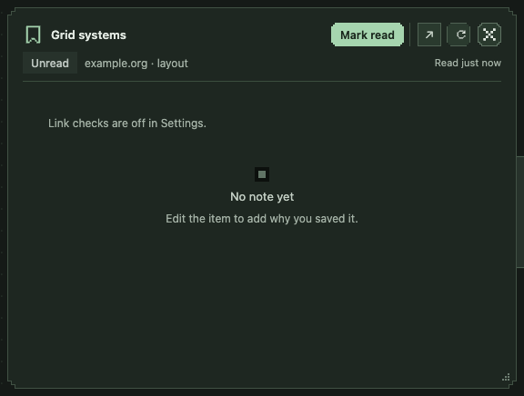

## Shared components

Plugin views are plain DOM; the app's React components are not part of the SDK. Use the same
look through these classes and helpers, and let the host render the rest.

| App component | In a plugin |
|---|---|
| `Button` | `<button class="btn" data-variant="primary|secondary|quiet|icon|danger|danger-solid|copper" data-size="sm|md">`; `aria-busy="true"` shows the spinner |
| `Chip` | `statusChip(document, { label, tone })` → `.view-chip[data-tone]` |
| `Notice` / `ErrorNotice` | `.view-stale-banner` with `role="status"` for one-line notices next to their cause |
| `FloatingPanel` | Not for plugins: your surface is the expanded view |
| `PixelCombobox`, `Segmented`, `DirectoryField`, switches and number fields | Declare settings fields or creation fields; the host renders them |
| Choice menus and the inline confirm | `contextMenu` groups with `choices`, or `openResourceChoices(...)` in a view |
| `PixelGlyph` | `pixelGlyphElement(document, name)` (8×8, `currentColor`) |

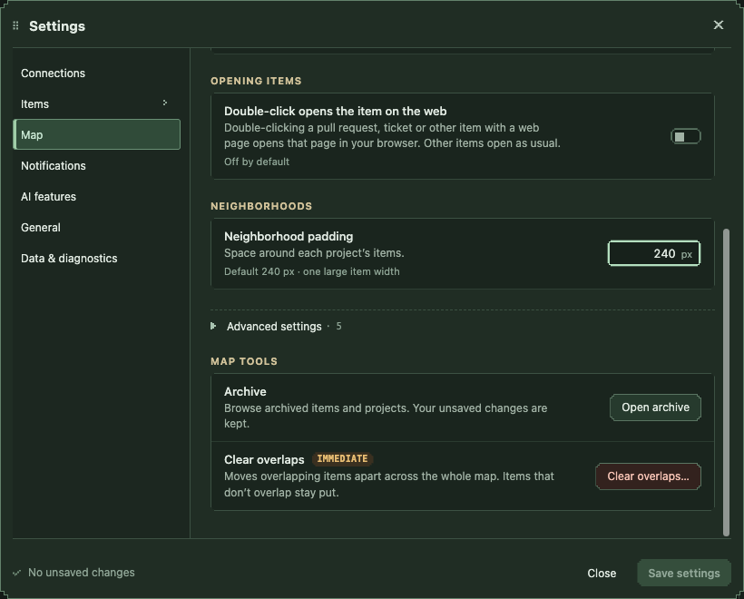

Settings sections are rendered from your fields with the same rows as built-in settings:

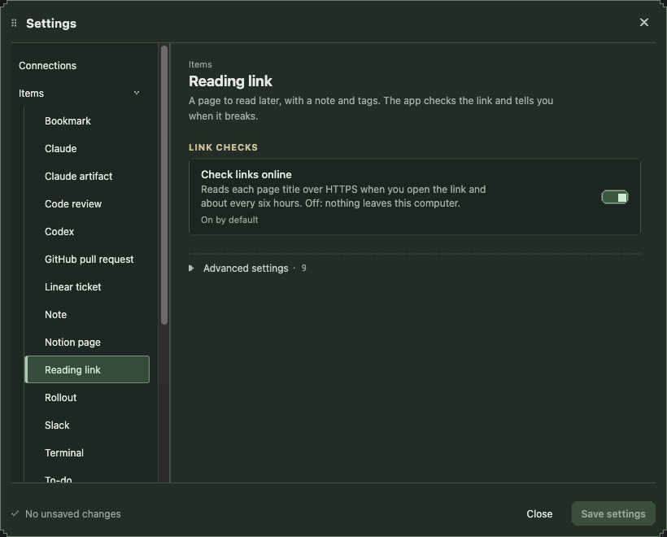

Choices from a runtime operation appear in the map menu like built-in ones:

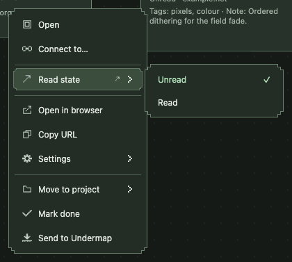

Your groups sit between Connect to… and Open in … by default, set off by a separator. The
person can move any top-level entry of your type's menu, yours included, move, add and
remove its separators, and hide single entries from the map menu, in Settings → Items →
Right-click menus; the order of the choices inside a group is yours and is not
reorderable. Do not rely on an entry's position, on a separator around your groups, or
on a group being in the map menu at all: if an action must stay reachable, also offer it
in your view. Do not change a group's `id` once released: saved layouts and hidden
entries refer to it as `plugin:<id>`. A group you add in a later version joins a menu the
person has arranged right after the entry it follows by default, without a separator.

## Irreversible actions

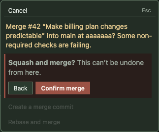

For writes that cannot be undone from the app (merge, approve a deployment, delete remotely):

1. The trigger is the `copper` button variant, never `primary`.
2. Use `choices: { load, apply, irreversible: true }` (or `openResourceChoices` with it). The menu
   then lists **Cancel** first with focus, and choosing an option asks again: "**Squash and
   merge?** This can’t be undone from here." with **Back** and a danger **Confirm**.
3. Declare the operation or action `humanOnly`; agents are refused.
4. One trigger per irreversible action in a view. Do not offer the same approval from the chip,
   a row and the timeline.

Do: "Merge ▾" → Cancel / Squash and merge → confirm. Don't: a primary "Approve" that acts on one
click, or a double-Enter that can merge.

For one option that should ask first but can be undone (close a pull request), give that option
`confirm: { prompt, note, action, text? }` instead of marking the whole group irreversible. It
expands in place like the irreversible confirm, says what the note says (no "can’t be undone"),
and `text` adds an optional field (e.g. a closing comment) sent as `input[text.field]` when not
blank. In a view, `openResourceChoices(..., { only: 'close' })` narrows the menu to that option
and opens straight into its confirmation.

## Needs me

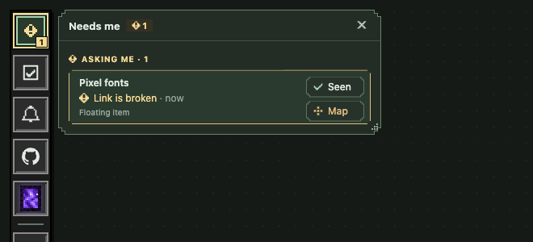

- The reason is the plugin's words, shown after the amber "!" in the list, in the card badge's
  tooltip and accessible name ("Needs me: Link is broken") and in notifications.
- 2–5 words, sentence case, no trailing period, names the trigger.

| Do | Don't |
|---|---|
| Link is broken | Error |
| Sync failed | The synchronisation with Acme has failed. |
| Build needs approval | ATTENTION REQUIRED |
| 2 new comments | You have new comments on this item which you should look at |

## Pixel icons

All icons are pixel glyphs from one set, `src/resource-plugins/pixel-glyphs.ts`: 12×12 for item
types and UI, 8×8 for status cues and small controls. Plugins pick names; they cannot ship glyphs.
To add one, change the app:

1. Draw it as row strings, `X` for a lit pixel. 12×12: leave row 0 empty and keep a 1 px margin;
   8×8: use the full grid. One-pixel strokes, a silhouette distinct from the existing glyphs, and
   readable in greyscale.

   ```ts
   // in PIXEL_GLYPHS[12]
   kite: ['............', '.....XX.....', '....X..X....', '...X....X...', '..X......X..', '...X....X...',
          '....X..X....', '.....XX.....', '......X.....', '.......X....', '......X.....', '............'],
   ```
2. Map a type icon name to it in `UI_GLYPHS` in `apps/desktop/renderer/icons.tsx` (or an 8×8
   status name in `STATUS_GLYPHS`).
3. Run `npm run test:visual` and look at the type at 100% and 45% zoom.

In views, draw 8×8 glyphs with `pixelGlyphElement(document, 'refresh')`; they inherit
`currentColor` and are `aria-hidden`. Never use Unicode symbols for close, more, refresh or
chevrons.

## Copy style

- Sentence case everywhere: type names, buttons, chips, menu items, settings labels.
- Buttons start with a verb: "Add to reading list", "Mark read". A menu item that opens more ends
  with "…".
- Labels lead with the state word: "Unread · example.org".
- Numbers and times are short: "3 of 5", "2 h ago", "Sep 25". No seconds.
- Errors say what happened and what to do, without codes or stack traces: "Couldn’t reach
  example.com. Check the address."
- Settings descriptions say what happens when the setting is on and when it is off.
- Use the typographic apostrophe (’) as the app does.

## Accessibility

- Every control has an accessible name; icon-only buttons get `aria-label` ("Refresh").
- Focus is always visible: `outline: var(--act-focus-ring); outline-offset: 2px` (`-2px` inside
  scrolling lists). Remove an outline only when the same control draws a replacement in
  `--act-focus`.
- Everything works from the keyboard: Tab reaches it, Enter and Space activate it, Escape is the
  host's (it closes menus, then the view). Do not trap focus.
- State is never colour alone: the chip has words, cues have glyphs.
- Body updates use `aria-live="polite"`; one-line notices use `role="status"`; only real errors
  interrupt.
- Text is at least 11 px (`--act-fs-meta`); 10 px (`--act-fs-caps`) is for uppercase labels and
  counts. Faint ink only on card, panel or raised surfaces.
- No animation of your own; the host's respects reduced motion.

## Review checklist

- [ ] Icon reads alone at 45% zoom; tone is identity, not status.
- [ ] Sizes declared only where they add something; default matches `appearance.size`.
- [ ] `label` leads with the state word and fits a medium card.
- [ ] No amber, rims, outlines or corner checks drawn by the plugin.
- [ ] View: title once, one chip with one job, meta line without labels, at most one primary action.
- [ ] Loading, empty, error and stale states use the shared helpers and copy.
- [ ] Irreversible actions: copper trigger, `irreversible: true`, `humanOnly`.
- [ ] Needs me reason is 2–5 words, sentence case, no period.
- [ ] Focus visible, keyboard complete, names on icon buttons, tokens only.
